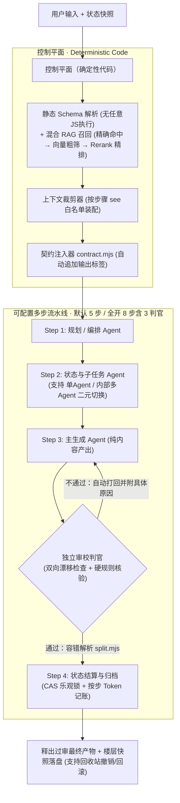

# 01 · 配置驱动型多 Agent 编排与审校工作台（V1 → V2~V4 架构演进）

> **一句话价值**：针对传统单轮长 Prompt“注意力稀释、写手自审失效、过程黑盒、输出易崩”四大痛点，主导构建了一套 **控制面与上下文面分离、完全配置驱动、未过审零释出** 的多 Agent 编排引擎与可视化工作台——并经历了一次彻底的 **V1（23,908 行）推倒重构 → V2~V4（5,290 行，瘦身 79%）** 工程复盘与产品化交付（发版至 `v4.16.1`）。

---

## 一、从 V1 到 V2~V4：为什么要果断砍掉 2.39 万行代码重做？

| 维度 | V1（一代原型） | V2~V4（归零重构定稿 `v4.16.1`） | 架构演进收益 |
| :--- | :--- | :--- | :--- |
| **代码体量** | 95 文件 / **23,908 行** / 52 条路由 | 30 文件 / **5,290 行**（核心引擎 ~5,000 行） | **代码复杂度压减 ~79%**，可维护性跃升 |
| **测试覆盖** | **867 条单测全绿** + HTTP 端到端冒烟 `74/74` | **284 条单测（约 1 秒跑完）** + `check-docs` 文档门禁 + `--fake` 压测 | 秒级反馈闭环，零成本门禁优先 |
| **角色耦合** | 内置固定角色、功能大而全但耦合重 | **零硬编码角色名**，纯配置驱动 + `see` 白名单精确裁剪上下文 | 领域无关，任意步骤可自由增删重排 |
| **交互形态** | 节点画布（坐标易冲突、子 Agent 藏太深） | **废弃画布 → 有序步骤列表 + 缩进子 Agent + 拖拽重排** | 实测交互效率显著优于传统连线画布 |
| **架构沉淀** | 跑通并发 DAG、CAS 乐观锁、5 层记忆、侧链 | 沉淀 **6 份正式 ADR** + 3 条工程铁律 + 混合 RAG + 单/多 Agent 无损切换 | 工程决策可追溯、可复用 |

> **核心复盘结论**（摘自原仓交接记录）：*“V1 看起来‘很全’，这正是它失败的原因。”* 当控制逻辑与业务角色强耦合、又为了兼容所有历史包袱不断叠功能时，每次迭代的回归与心智成本呈指数上升；通过 **6 份 ADR** 重新划清边界后，用 21% 的代码量实现了更稳、更易扩展的核心闭环。

---

## 二、核心架构图（控制平面 vs. 上下文平面）

---

## 三、三大架构铁律与核心工程实现

1. **铁律 1：引擎领域无关（配置驱动 + 最小可见性隔离）**
   - 代码中不写死任何具体角色名；每个 Agent 步骤通过 `see` 白名单精确声明可见输入，彻底杜绝全量上下文灌入导致的注意力稀释与信息越权。
   - **按步 Token 精确记账**：每一步独立统计输入/输出消耗，支持默认 5 步快速模式（实测 `12–18s`）与 8 步全开 3 判官严审模式（实测 `~23s / 8–10 次调用`），且兼容 **Anthropic + OpenAI 双模型协议路由**。
2. **铁律 2：模型只产内容，契约生成与容错解析由引擎托管**
   - `contract.mjs` 在运行时自动把输出格式标签拼到提示词末尾，不靠人工在每个 Prompt 里重复维护格式说明；
   - 针对大模型高频漏写闭合标签的通病，`split.mjs` 实现宽容降级（开标签在、闭标签缺时截取至文末并写入诊断列表，不无谓打断流水线）。
3. **铁律 3：机械判定归代码，主观质量归独立审稿 Agent**
   - **安全与确定性**：静态 AST 解析 Zod 变量结构（支持中文键与点路径补丁，**绝不执行不可信第三方脚本**）；二进制/结构化资产导入导出通过 **SHA-256 字节级无损往返校验**；支持楼层时间旅行式快照回滚与导出导入自动备份。
   - **混合语义召回（Hybrid RAG）**：落地 `名字/别名精确命中 → 向量粗筛 → 精排排序（Rerank）` 检索链路，兼顾实体召回精度与语义泛化。

---

## 四、技术向产品与工程细节亮点（V1–V4 全周期实证）

- **产品交互敢于做减法**：在完成节点画布的四边锚点与平滑曲线后，基于真实高频编辑体验，**果断废弃低效画布**，重构为「有序步骤列表 + 缩进子 Agent + 拖拽重排（拖至违规位置不粗暴阻断，而是自动解绑失效读取；本地草稿态编辑，点保存才校验写盘）」。
- **高一致性数据与并发设计**：
  - V1 落地 `POST /api/config` 基于 `expectedRevision` 的 **CAS 乐观锁**（冲突返回 `409 revision_conflict`）与密钥脱敏回显；
  - 落地自动/手动双路径幂等摘要契约（自动路径保留阈值门控 + fire-and-forget 异步执行，手动 `force=true` 无新内容时原地覆盖 `replaced:true`、ID 不变、账本不膨胀）；
  - V3 落地 **产出改名自动级联更新全引用** 与 **单 Agent / 内部多 Agent 二元无损切换**。
- **深度阅读拓展**：
  - [核心架构决策记录精选（ADR Highlights）](./adr-highlights.md)
  - [多 Agent 权限「三问归属法」与防污染模式](./patterns.md)
