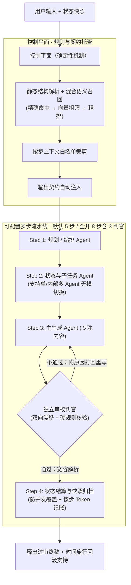

# 01 · 配置驱动型多 Agent 编排与审校工作台（V1 → V2~V4）

> **角色与分工**：本人主导产品定位、架构归零重构决策、6 份 ADR 规范制定、交互做减法及端到端验收；具体编码与自动化测试协同 AI Coding 工具迭代落地。

---

## 一、核心案例复盘（STAR）

### S · Situation（背景与痛点）
在长程 AI 互动与复杂内容生成场景中，传统单轮超长 Prompt 存在四个难以根治的痛点：**注意力稀释、写手自审失效、生成过程黑盒、输出格式易崩**。  
第一代原型（V1）虽然跑通了多步编排、并发与多层记忆，但因为把具体业务角色写死在引擎里、且不断叠加历史兼容补丁，导致系统迅速臃肿，每次迭代的回归与维护成本呈指数上升——**“V1 看起来很全，这正是它失败的原因。”**

### T · Task（核心目标）
在不牺牲质量控制的前提下，推倒重构出一套**领域无关、纯配置驱动、上下文可控、未过审零释出**的多 Agent 编排与审校工作台，并把真实高频使用时的配置效率与 Token 成本压到可长期日常运行的水平。

### A · Action（本人主导的关键决策与动作）
1. **果断归零重构，定下 3 条架构铁律**
   - **引擎领域无关**：彻底剥离硬编码角色名，任何业务步骤均通过配置编排，并通过每步显式**可见性白名单**裁剪上下文，避免全量信息灌入导致稀释与越权。
   - **契约托管与宽容解析**：将输出格式约定与异常容错收归引擎统一管理，不靠人工在每份 Prompt 里反复堆砌格式提醒，解决大模型漏写闭合标记导致整轮中断的通病。
   - **确定性归代码，主观评审归独立判官**：把静态结构校验、资产无损导入导出、快照回滚与按步 Token 记账交给确定性机制；主观质量交由独立审校 Agent 做双向漂移检查，不通过直接附原因打回重写。
2. **产品交互敢于做减法**
   - 在实际高频配置测试中，发现传统“节点连线画布”在多步编排与子 Agent 嵌套场景下极易遮挡、连线繁琐、心智负担高。
   - 果断**废弃已做好的连线画布**，改版为**「有序步骤列表 + 缩进子 Agent + 拖拽重排 + 草稿态编辑后统一校验落盘」**，并补齐单 Agent 与内部多 Agent 的无损切换及产出改名自动级联更新。
3. **沉淀检索与安全边界**
   - 确立三段式混合召回链路（精确实体命中 → 向量粗筛 → 语义精排），兼顾长程设定召回精度与泛化；
   - 禁止执行不可信外部脚本，用静态结构解析替代动态执行，确保跨模型（双协议路由）安全可控。

### R · Result（可验证结果）
- **复杂度大幅瘦身**：相比 V1，重构后的 V2–V4 核心体系整体复杂度压减 **~79%**，全量自动化单测可在 **约 1 秒** 内跑完并配套文档一致性门禁与假模型压测。
- **速度与质量双闭环**：支持默认 5 步快速模式（实测 `12–18s`）与全开 8 步含 3 判官严审模式（实测 `~23s`）自由切换，按步精确记账，持续稳定迭代发版至 `v4.16.1`。
- **方法论可迁移**：全过程沉淀为 **6 份正式架构决策记录（ADR）** 与权限归属规范，可直接复用于任意多 Agent 审校或生成工作流。

---

## 二、核心架构一览（控制面 vs. 上下文面）

---

## 三、实机运行界面（有序步骤编排 · 多 Agent 审校判官 · 独立隔音室辩论 · 已脱敏）

1. **有序步骤列表与自动结构化执行流（废弃节点画布后的最终交互形态）**：左栏常驻提示词与中栏 CoT 步骤支持双向拖拽分类与上下排布，程序自动将 19 步结构化为 2 段执行流并在挂载工具/副 AI 处自动断点，代码直连抽取零重复注入。

2. **副 AI 顾问团（多 Agent 并发审校 + `see` 最小视野白名单）**：每个审校节点只接收 `2k–5k` 精简白名单上下文（不灌 `60k` 全图），硬伤未过审直接附原因打回重写。

3. **读书研讨会（独立 API 隔音室 + 深度沉浸多边 Persona 防从众辩论）**：多角色各自独立视角盲投再多轮互怼，最后由主编汇总验证拍板 Final Plan，避免单一模型“自问自答、互相附和”。

---

## 四、延伸细节索引（给想看底层决策的读者）

| 文档 | 内容摘要 |
| :--- | :--- |
| **[核心架构决策记录精选（ADR Highlights）](./adr-highlights.md)** | 6 份 ADR 的背景、权衡与弃选方案（含控制面/上下文面分离、废弃画布改列表、容错解析与并发防冲突设计） |
| **[多 Agent 权限「三问归属法」与防污染模式](./patterns.md)** | 角色边界划分、上下文最小可见性、防信息越权与幂等摘要契约细节 |
