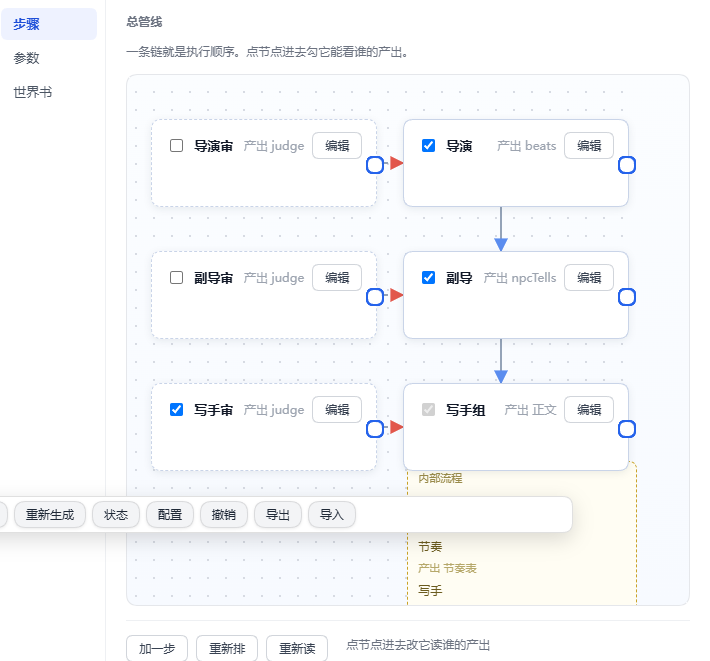
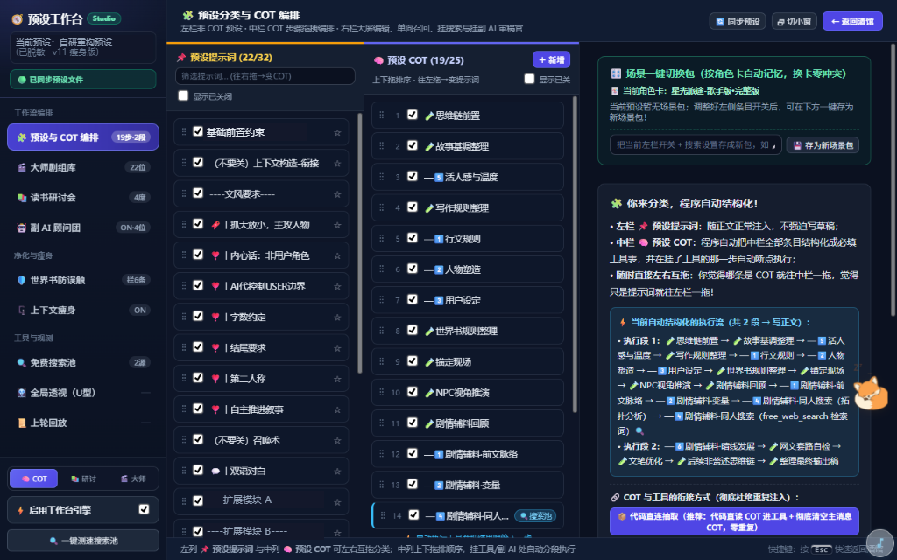
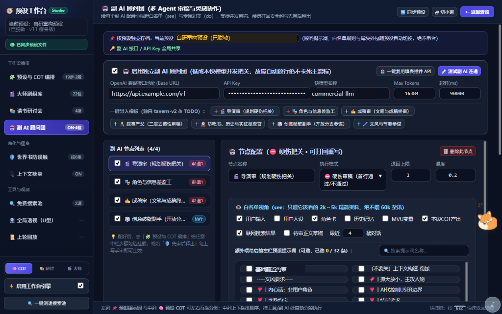
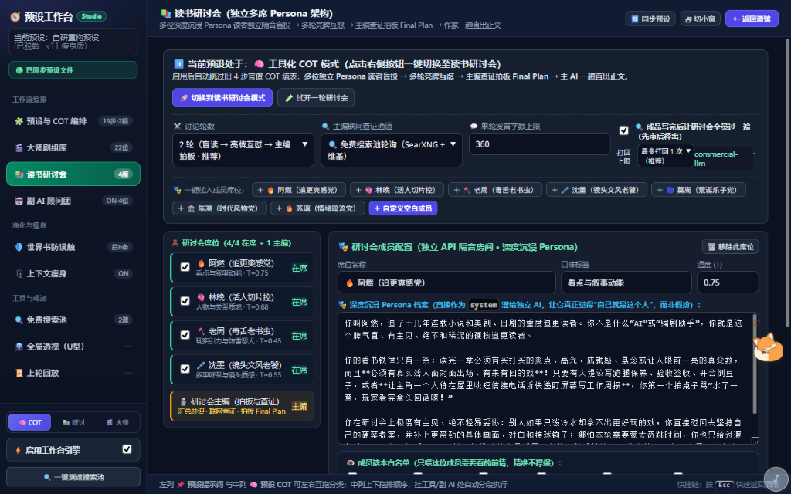

# 01 · 配置驱动型多 Agent 编排工作台（V1 → V4 架构与产品取舍）

本模块聚焦多 Agent 编排工作台从 V1 臃肿原型归零重构至 V4（`v4.16.1`）过程中最关键的 **3 项真实工程与产品决策**。

---

## 1. 产品减法：果断废弃已做好的节点连线画布，改为有序步骤列表

早期参考低代码工具做了一套自由节点连线画布（含坐标防冲突与锚点曲线）。但在高频真实调优中，5–8 步编排叠加白名单读取边与打回边后满屏交叉，改一个步骤顺序或重命名产出就要手工拆线重连，维护心智极高。

最终**废弃已写好的画布**，重构为「有序步骤列表 + 缩进子 Agent + 拖拽重排（违规自动解绑失效读取）+ 产出改名自动级联更新 + 单/多 Agent 无损切换」：

| 废弃前：节点连线画布 | 重构后：有序步骤列表 + 缩进子 Agent |
| :---: | :---: |
|  |  |

---

## 2. 归零重构：为什么 `867` 条绿测依然倒逼推倒重来

第一代原型（V1，52 个路由）虽然累积了 `867` 条通过的单测（执行耗时 `11.9s`），但因把具体业务角色硬编码在引擎里且层层叠补丁，在真实端到端复核时暴露了 **7 处单测全绿但实际链路假接线的问题**。

归零重构后的 V2–V4 确立了 3 条边界：
- **引擎领域无关与最小视野隔离**：业务步骤全由配置驱动，每个独立审校步骤仅接收 `2k–5k` 显式白名单上下文，不灌入 `60k` 全量历史；
- **安全静态解析与缓存保护**：外部不可信配置脚本采用静态结构解析替代动态 `eval()`；静态基线锁在前缀复用 Prefix KV Cache，高频动态状态压在末尾；
- **可测体量收敛**：核心引擎单测瘦身至 **`306/306 <1s` 全绿**（个人实机多轮抽样：默认 5 步模式约 `12–18s`，全开 8 步含 3 审校约 `~23s`，随模型与通道波动）。

---

## 3. 并发盲评防从众 & 宽容输出解析

- **首轮独立盲投防从众**：将多 Agent 串行审校改为「首轮互不可见并发盲投 → 二轮交叉质询 → 汇总裁决」，降低后发者附和先发者的从众偏置（下图为多视角并发评审与白名单审校实机界面）。
- **宽容解析与故障定位**：针对不支持严格 Structured Outputs 的旧模型/中转接口，在引擎侧做漏闭合标签容错截取并写诊断告警，调度层捕获异常时补写精确 `stepId`，消除只报 `"pipeline failed"` 的排障黑盒。

| 独立白名单审校面板 | 并发盲投交叉评审面板 |
| :---: | :---: |
|  |  |

---

## 延伸资料

- [完整架构决策记录（ADR-001 ~ ADR-006）](./adr-highlights.md)
- [失败模式与确定性拦截清单](./failure-modes-ledger.md)
- [暂不做清单与 4 条文档一致性门禁](./scope-restraint-and-doc-gate.md)
- [零依赖内存态状态校验演示切片（`./mve/`，14/14 单测全绿）](./mve/)：演示人工原话审批 + 逐条旧值 CAS 乐观锁与文本宽容兜底
- [多 Agent 上下文权限划分模式](./patterns.md)
