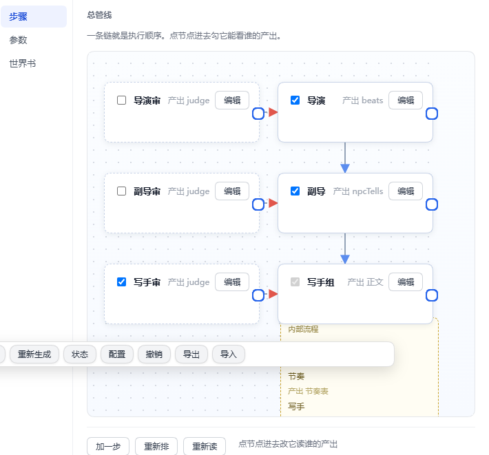

# 架构决策记录全集（ADR-001 ~ ADR-006 · 脱敏整理版）

> 以下 6 份 ADR 完整整理自多 Agent 编排引擎 V1（`23,908` 行）→ V2–V4（`v4.16.1`）归零重构期的真实架构决策文档，展示面对 LLM 不可控性、不可信输入安全、评测指标扭曲（Goodhart 效应）、KV Cache 成本保护、复杂编排交互心智以及输出契约容错/并发安全时的工程权衡思路。

---

## ADR-001：控制平面（代码）与上下文平面（Prompt）彻底分离

- **状态**：Accepted
- **痛点**：传统单轮全量 Prompt 模式把所有规则、历史与背景一股脑塞给同一个模型，导致三大结构性失效——① 长上下文注意力稀释，关键约束随机丢失；② 生成者同时兼任裁判，违规输出会被自我合理化；③ 无法在落盘/提交前插入确定性硬校验。
- **决策**：
  1. **控制平面（Deterministic Code）**：负责工具调度、状态机流转、子 Agent 编排、入参/出参门禁（Plan Gate / Commit Gate）与失败回滚——决定**谁在何时被调用、能看见什么、什么算过关**。
  2. **上下文平面（Cropped Prompt）**：每个 Agent 每次调用仅接收由代码按白名单裁剪后的局部视图（Local View），禁止跨职责读取无关上下文。
- **明确否决的反模式**：
  - 将多角色塞进同一段超长 CoT 里靠模型“自觉分饰多角”；
  - 让主生成 Agent 自审自己刚写完的输出。
- **代价与权衡**：引入了资产分类、检索器、上下文装配器与状态存储的工程复杂度，换取了**每阶段可独立单测、可打回重跑、可定点回滚**的工程确定性。

---

## ADR-002：声明式模块配置 + 静态解析，严禁执行不可信脚本

- **状态**：Accepted
- **痛点**：允许业务配置直接附带任意 JS/TS 脚本看似灵活，但在 AI 工作流场景下带来四个致命隐患——① 不可信外部资产存在任意代码执行安全风险；② LLM 改坏脚本后极难定位；③ 宿主 API 变动会导致全量存量资产失效；④ 逻辑与状态混杂，无法 diff 与快照回滚。
- **决策**：
  - 采用 **声明式配置（YAML/JSON）+ 共享策略引擎 + 独立状态快照**；
  - 对既有外部资产中的 Schema 定义（如 Zod 脚本），实现 **静态 AST 解析器（`zod.mjs`，不执行代码）** 提取字段层级、默认值与嵌套结构。
- **收益**：资产天然可读、可 Git diff、可被 AI 工具安全修改、支持毫秒级楼层快照回滚。

---

## ADR-003：滑动窗口趋势评估 + 双向漂移检查（对抗 Goodhart 效应）

- **状态**：Accepted
- **痛点**：早期评测规则设定了“每轮必须满足 X 配额/必须制造冲突或反转”的刚性指标。实测很快触发 **Goodhart 定律**——模型把配额当成唯一 KPI 过度满足，导致输出机械化、全员敌意拉满、丧失自然节奏。
- **决策**：
  1. **废弃单轮刚性配额，改用滑动窗口趋势评估（Sliding-Window Check）**：在最近 3–5 轮窗口内检查整体分布与节奏推进，而非逼迫每一轮都塞满要素；
  2. **建立「契约参数（Contract）」而非静态禁令**：暴露可调节的多维风格/张力参数与场景类型路由；
  3. **审校 Critic 执行「双向漂移检测」**：同时监控两个极端——**过度平滑/附和漂移（Flat / Sycophancy Drift）** 与 **过度对抗/犬儒漂移（Hostile / Grimdark Drift）**，防止防 A 过度导致反向 B 崩坏。
- **工程启示**：这一原则同样直接适用于通用 LLM Eval Rubric 设计——任何单向严苛的评测项都会把模型推向另一端极端，必须采用**双向均衡校验 + 窗口级分布评估**。

---

## ADR-004：静动分层 Prefix Cache 保护与无偏差 U 型注意力 X 光诊断

- **状态**：Accepted
- **痛点**：长程多轮与多步工具调用中，若将高频变动的动态状态变量或每轮裁定随意插进前半段上下文，会从首 Token 击穿商业 API 的 **Prefix KV Cache**（每轮全量重算烧钱）并破坏推理模型的 **Thinking Signature**；同时若将独立通道的 `data.tools` Schema 混入正文统计占比，会挤偏末尾注意力区间的真实位置评估。
- **静动分层架构图**：

- **核心工程取舍**：
  1. **剥离 `data.tools` 单独统计**：闭源 API 的工具定义走独立参数通道，单独核算避免掩盖正文真实占比；
  2. **跨区大条目显式标出**：对跨度极大的单条知识库条目显式标记跨区状态，避免中点值掩盖“头尾被稀释”风险，并将当轮强约束集中放到末尾高注意力区；
  3. **固定序列化键序**：快照输出按确定性字典序序列化，确保跨轮前缀字节级一致，不因键顺序抖动失效缓存。

---

## ADR-005：废弃节点连线画布，改用有序拖拽步骤列表与单/多 Agent 无损切换

- **状态**：Accepted
- **痛点**：早期参考主流低代码工作流实现了自由节点连线画布（已完成节点坐标防冲突与四边锚点曲线渲染），但在真实高频调优中暴露出显著交互负收益——① 5~8 步编排叠加 `see` 视野读取边与判官打回边后满屏拉线交叉，视觉连线噪音淹没了核心提示词内容；② 调整步骤顺序、缩进嵌套子 Agent 或重命名中间产物时，手工拆线重连极易遗漏下游引用导致静默断链；③ 用户在“轻量单模型直出”与“多 Agent 审校管线”之间切换时被迫维护两套割裂配置。
- **决策**：
  1. **果断废弃已跑通的节点连线画布**，收敛为 **「有序步骤列表 + 缩进子 Agent + 拖拽重排」** 交互范式；
  2. **引用自愈与草稿态静态门禁**：将步骤向前拖拽越过其依赖产出的生成步时，自动解绑失效的 `see` 引用并显式高亮提示；修改任意步骤产出键名时**自动级联更新**全局下游引用；所有界面改动先落本地草稿态，保存时集中执行拓扑与契约静态校验；
  3. **单 Agent / 内部多 Agent 二元无损切换**：底层共享同一套世界书、变量 Schema 与楼层快照契约，支持一键无损切换执行模式。
- **代价与权衡**：舍弃了已完成开发的自由网状画布代码与任意环路表达力，换取了高频调序零断链、屏幕空间聚焦规格正文以及极低的日常维护心智。
- **真实演化实拍对照（`v1.88.0` 自由连线画布 → `v1.93.0` 果断废弃改有序步骤列表 + 缩进子 Agent）**：

| ❌ BEFORE：自由节点连线画布（`v1.88.0`） | ✅ AFTER：有序步骤列表 + 缩进子管线（`v1.93.0`） |
| :---: | :---: |
|  |  |

---

## ADR-006：宽容输出契约解析（免重跑降本）与跨代写盘安全演进（V1 乐观锁 → V2–V4 HITL 提案 CAS 与 WAL 幂等回退）

- **状态**：Accepted（含 V1 → V2–V4 跨代演进记录）
- **痛点**：① 多步 Agent 链路中，跨家族模型偶发漏写末尾闭合标签（如输出 `<draft>` 后漏写 `</draft>`）、在定界符外附带内部结算块，或在判官理由中写出“前半句通过但整体不通过”触发子串误判；若一刀切判失败整步重跑，既拖慢延迟又白烧数万 Prompt Token；② 后台异步状态更新、AI 擅自改写长期存档及多类存储回退中途崩溃，若采用传统覆盖写（Last-Write-Wins），会导致并发覆盖、状态漂移或时间线撕裂。
- **决策**：
  1. **输出契约托管与引擎预填包壳（`assemble.mjs` + `run.mjs`）**：各步骤仅声明职责与审校判据，输出契约由 `assemble.mjs` 统一注入；单产出步骤由 `run.mjs` 预填开标签并自动补闭，配套 `allowEmpty: true` 防空转凑废话，以及释出前 `stripMeta` 剥离 `
/<UpdateVariable>/<Analysis>/<JSONPatch>` 内部块；
  2. **四态宽容解析与防误判判决（`split.mjs` + `run.mjs` · 见可运行切片 [`mve/tolerant-splitter-and-verdict.mjs`](./mve/tolerant-splitter-and-verdict.mjs)）**：
     - 严格闭合提取 → 漏闭标签安全截取至文末并记 `notes` 诊断告警免付费重跑 → 同标签按序拼接 → 单产出无标签整段收下 / 多产出 `## 标题` 回退；
     - 判官判决 `readVerdict` 仅扫前 5 个非空行且**严格先判否定（`不通过`）再判肯定（`通过`）**，杜绝理由段子串反转误判；
  3. **跨代并发与写入安全演进（V1 → V2–V4 · 见可运行切片 [`mve/hitl-proposal-gate.mjs`](./mve/hitl-proposal-gate.mjs)）**：
     - **V1 阶段**：在配置存储与时间线层落地 HTTP `409 Conflict`（`expectedRev` 短哈希）与 `{branchId, revision}` 乐观锁（迟到异步结算返回 `STALE_SETTLEMENT` 永不覆写新正文），配合 `fs-atomic.mjs` 对 Windows `tmp + rename` 的 `EPERM/EACCES/EBUSY` 句柄冲突做退避重试；
     - **V2–V4 阶段演进**：收敛为更严格的 **HITL 人机共治写入门禁（`proposal.mjs`）**——AI 只能带正文原句（`≥6` 字）与来源楼层生成待审提案（任一条不合规则整份拒收），`applyProposal` 物理不暴露为模型工具、只能由人带确认原话从 UI 触发，落盘前**逐条 CAS 重验旧值**（防审批期间状态漂移）并追加不可变 `变更日志.jsonl`；同步在 `disk.mjs` 落地 **7 类存储统一注册表（`STORES`）+ `回退中.json` WAL 崩溃幂等恢复 + 回收站一键撤销回退**。
- **收益**：在确保入库数据 100% 符合契约且“AI 绝不能自批写盘”的前提下，消除了轻微闭合瑕疵引发的无谓重跑损耗，并从机制上杜绝并发静默覆写与回退半截态损坏。
