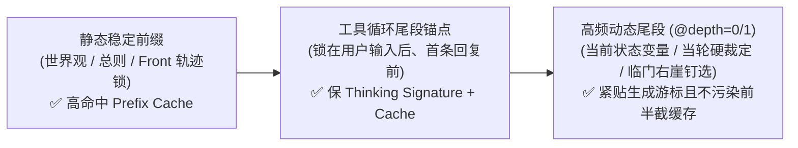

# 精选架构决策记录（ADR Highlights · 脱敏整理版）

> 以下 3 份 ADR 提炼自多 Agent 编排引擎 V1→V2 重构期的真实架构文档（共 6 份 ADR），展示面对 LLM 不可控性、不可信输入安全与评测指标扭曲（Goodhart 效应）时的工程权衡思路。

---

## ADR-001：控制平面（代码）与上下文平面（Prompt）彻底分离

- **状态**：Accepted
- **痛点**：传统单轮全量 Prompt 模式把所有规则、历史与背景一股脑塞给同一个模型，导致三大结构性失效——① 长上下文注意力稀释，关键约束随机丢失；② 生成者同时兼任裁判，违规输出会被自我合理化；③ 无法在落盘/提交前插入确定性硬校验。
- **决策**：
  1. **控制平面（Deterministic Code）**：负责工具调度、状态机流转、子 Agent 编排、入参/出参门禁（Plan Gate / Commit Gate）与失败回滚——决定**谁在何时被调用、能看见什么、什么算过关**。
  2. **上下文平面（Cropped Prompt）**：每个 Agent 每次调用仅接收由代码按白名单裁剪后的局部视图（Local View），禁止跨职责读取无关上下文。
- **明确否决的反模式**：
  - 将多角色塞进同一段超长 CoT 里靠模型“自觉分饰多角”；
  - 让主生成 Agent 自审自己刚写完的输出。
- **代价与权衡**：引入了资产分类、检索器、上下文装配器与状态存储的工程复杂度，换取了**每阶段可独立单测、可打回重跑、可定点回滚**的工程确定性。

---

## ADR-002：声明式模块配置 + 静态解析，严禁执行不可信脚本

- **状态**：Accepted
- **痛点**：允许业务配置直接附带任意 JS/TS 脚本看似灵活，但在 AI 工作流场景下带来四个致命隐患——① 不可信外部资产存在任意代码执行安全风险；② LLM 改坏脚本后极难定位；③ 宿主 API 变动会导致全量存量资产失效；④ 逻辑与状态混杂，无法 diff 与快照回滚。
- **决策**：
  - 采用 **声明式配置（YAML/JSON）+ 共享策略引擎 + 独立状态快照**；
  - 对既有外部资产中的 Schema 定义（如 Zod 脚本），实现 **静态 AST 解析器（`zod.mjs`，不执行代码）** 提取字段层级、默认值与嵌套结构。
- **收益**：资产天然可读、可 Git diff、可被 AI 工具安全修改、支持毫秒级楼层快照回滚。

---

## ADR-003：滑动窗口趋势评估 + 双向漂移检查（对抗 Goodhart 效应）

- **状态**：Accepted
- **痛点**：早期评测规则设定了“每轮必须满足 X 配额/必须制造冲突或反转”的刚性指标。实测很快触发 **Goodhart 定律**——模型把配额当成唯一 KPI 过度满足，导致输出机械化、全员敌意拉满、丧失自然节奏。
- **决策**：
  1. **废弃单轮刚性配额，改用滑动窗口趋势评估（Sliding-Window Check）**：在最近 3–5 轮窗口内检查整体分布与节奏推进，而非逼迫每一轮都塞满要素；
  2. **建立「契约参数（Contract）」而非静态禁令**：暴露可调节的多维风格/张力参数与场景类型路由；
  3. **审校 Critic 执行「双向漂移检测」**：同时监控两个极端——**过度平滑/附和漂移（Flat / Sycophancy Drift）** 与 **过度对抗/犬儒漂移（Hostile / Grimdark Drift）**，防止防 A 过度导致反向 B 崩坏。
- **工程启示**：这一原则同样直接适用于通用 LLM Eval Rubric 设计——任何单向严苛的评测项都会把模型推向另一端极端，必须采用**双向均衡校验 + 窗口级分布评估**。

---

## ADR-004：静动分层 Prefix Cache 保护与无偏差 U 型注意力 X 光诊断

- **状态**：Accepted
- **痛点**：长程多轮与多步工具调用中，如果把高频变动的动态状态变量、每轮裁定结果或工具回插位置随意塞进前半段上下文，会从首 Token 处击穿商业 API 的 **Prefix KV Cache**（导致每轮全量重算烧钱）并破坏推理模型的 **Thinking Signature**；同时，调优时若不剥离独立通道的 `data.tools` Schema，直接按总字数算比例，会严重挤偏右崖（85–100%）注意力区间的真实诊断结果。
- **静动分层架构图**：



- **核心亮点代码切片（真实上下文 U 型注意力 X 光分区逻辑）**：

```javascript
// 真实正文 U 曲线总字数（刻意排除独立通道的 data.tools Schema，避免挤偏右崖百分比）
const totalChars = Math.max(1, merged.reduce((s, x) => s + x.chars, 0));
let cursor = 0;
const items = merged.map(item => {
  const startPct = (cursor / totalChars) * 100;
  cursor += item.chars;
  const endPct = (cursor / totalChars) * 100;
  let zone = 'middle_valley';
  if (startPct < 12 && endPct <= 15) zone = 'left_high';          // 左崖高注意力区
  else if (startPct < 12 && endPct > 15) zone = 'span_left_mid';  // 跨左崖-谷底
  else if (endPct > 85 && startPct >= 82) zone = 'right_high';    // 右崖临门高注意力区
  else if (endPct > 85 && startPct < 82) zone = 'span_mid_right'; // 跨谷底-右崖
  return { ...item, startPct, endPct, midPct: (startPct + endPct) / 2, zone };
});
// 工具定义单独走 toolsMeta 独立展示，不参与正文 U 曲线占比计算
```

- **为什么这么设计？**
  1. **剥离 `data.tools` 防诊断失真**：闭源 API 的工具 Schema 走独立参数通道，若混进 `data.messages` 算总长，动辄几万字的工具定义会把原本落在末尾高权重区的规则“挤”成假谷底，误导调优方向；
  2. **引入 `span_*` 跨区态**：真实提示词里存在单条跨度极大的块（如 8k 字大世界书），仅靠中点 `midPct` 会掩盖“头在崖边、尾掉进谷底”的截断风险，显式标出 `span_left_mid / span_mid_right` 才能驱动后续**零重复物理搬运至右崖 99.9%**；
  3. **JSON/YAML 键序锁死**：快照序列化强制固定键序，确保跨轮前缀字节级一致，不因键顺序抖动白白失效缓存。

---

> 💡 **注（7:3 知识产权与面试演示声明）**：为保护原创工程与规则资产免受自动化爬虫滥用，本仓库公开核心架构原理、ADR 权衡、代表性代码/Spec 切片与真实消融对照数据；完整的多 Agent 编排工作台（`v4.16`）与全套运行引擎支持于业务面试中**现场屏幕共享实机演示与任意极端 Case 当场压测**。
