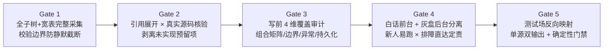
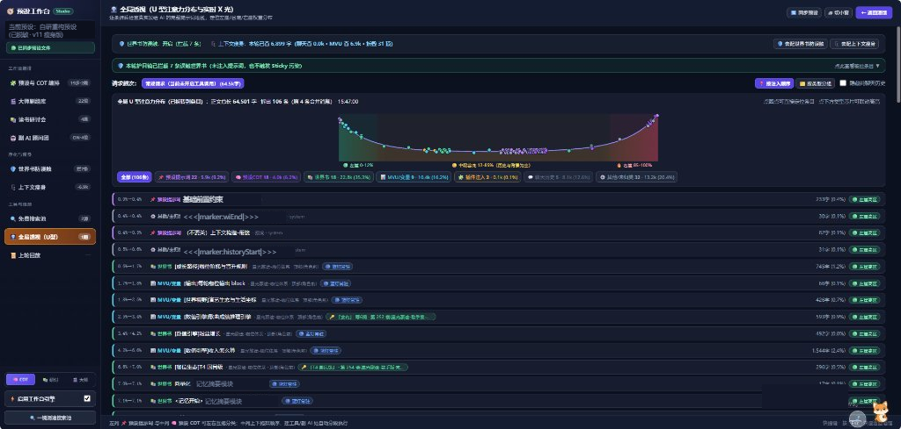

# 02 · AI 评测、源码对齐防幻觉与动态仿真压测体系

> **角色与分工**：本模块的方法论（5-Gate 审校管线、双层用例标准、500 轮仿真验收指标、CI 根因分流规则）均由 **本人主导设计与实机验收**，配套自动化脚本协同 AI Coding 工具完成并封装为可复用 Skill。所有商业项目案例均已彻底脱敏。

---

## 一、案例 A：5-Gate 文档×源码防幻觉 QA 体系（STAR）

### S · Situation（背景与痛点）
在大型开放世界商业研发管线中，直接把策划文档喂给大模型生成测试用例几乎不可用：文档过期或含未开发规划、宽表拉取静默截断、忽略嵌入子文档导致漏测、用例要么全是代码术语（新人看不懂）要么过于泛化（出 Bug 无法定责）。同时，CI 导表与配置检查每日报错量大，传统人工只看表层日志极易误判责任人。

### T · Task（核心目标）
建立一套**防 AI 幻觉、对齐真实代码、新人易执行且资深易排障**的标准化测试用例与测试场验证流程，并配套 CI 配置管线的自动化根因归因闭环。

### A · Action（本人主导的关键动作）
1. **叫停“盲目 AI 批量产出”，重构 5-Gate 串行门禁**
   - 对首批 AI 协助生成的 1,162 条用例果断叫停并主导全量独立复核，据此提炼出强制串行的 **5-Gate 规范**（已沉淀为可复用 Agent Skill）：
     - **Gate 1–2（全量采集 × 源码核验）**：强制核验文档完整性与嵌入引用，并对照真实客户端/服务端源码把需求拆为三类——**现网可测 / 未落地预留隔离区 / 跨文档冲突清单**，从源头杜绝假 Bug。
     - **Gate 3（写前 4 维覆盖审计）**：强制展开状态互斥组合矩阵、边界异常与持久化场景，并绑定可执行验证锚点。
     - **Gate 4（前台白话 × 后台灰盒分离）**：执行步骤列零代码术语确保新人秒上手；排查辅助列内嵌协议/开关/日志定位锚点，提单即可直达定责。
     - **Gate 5（测试场反向映射 + 单源双输出）**：由用例反推测试地图摆桩规格，脚本同源导出评审稿与导入表并通过格式/防重/乱码确定性门禁。
2. **闭环测试场实机验证与 CI 三维归因设计**
   - 结合引擎自动化能力搭建专用闭环测试地图并亲手实机验收；
   - 针对 CI 导表报错，制定“母体变更级联 / 资源删除残留 / 版本锁占用”三维排障归因与飞书去重催办规范，协同 AI Coding 落地免依赖自动化排查脚本。

### R · Result（可验证结果）
- **文档与需求纠偏**：全量体系覆盖 **28 个核心模块**，提前暴露 **400+ 项策划需求缺口与口径冲突**；核心 3C 样板模块经源码交叉核验，直接拦截 **5 处跨文档冲突**、剥离 **4 项未开发预留项防假 Bug**。
- **测试场覆盖率跃升**：由用例反推 26 组场景摆桩并在引擎内闭环验证，单图适用用例覆盖率由 **70.0% 提升至 98.6%**（**P0 冒烟覆盖率 74.2% → 100%**），实机验收挖出 2 个客户端隐藏真 Bug。
- **CI 排障闭环**：实现配置/导出异常一键追溯真实责任人与跨日逾期提醒，大幅减少误归因沟通损耗。

---

## 二、案例 B：复杂 AI 规则系统的 500 轮动态仿真压测（STAR）

### S · Situation（背景与痛点）
在设计包含多变量成长曲线、衰减因子、概率触发与多规则结算的长程 AI 互动/模拟系统时，仅靠上线跑几轮“看体感”根本测不出长周期隐藏崩盘（例如跑几十轮后数值永久卡死或静默流失拖垮整条成长线）。

### T · Task（核心目标）
把复杂规则与数值从“人工肉眼试玩”升级为**可重复、低成本的离线仿真验收体系**，在正式投入大模型调用前提前拦出系统级数值与状态机缺陷。

### A · Action（本人主导的关键动作）
1. **构建“规则单源编译 + 500 轮动态仿真”验收标准**：确立多场景轨道（约 10 年周期、500 轮）的离线跑批指标，检查冷启动可达性、长期增长上限、衰减收敛与同轮写入次序。
2. **基于仿真报告逐项做根因校准**：
   - 针对初始值为 `0` 时纯乘法公式永久卡死问题，引入最小保底增量与上限校准；
   - 修正静默流失按轮复利叠加导致的年化崩盘，设定衰减步长与回落期上限；
   - 消除同轮多规则读写竞态，确立 **7 步确定性单轮结算顺序**，并用静态穿透检查清理跨文件悬空引用。

### R · Result（可验证结果）
- **上线前一次性拦截 11 项系统级缺陷**（含冷启动永久死锁、复合衰减率单位错误、同轮多规则竞态与跨文件键名错配），避免真实长程对话跑至中后期才暴露不可逆崩盘。

---

## 三、可运行脚本与延伸细节索引

以下脚本均已彻底脱敏且零第三方依赖，有兴趣了解实现细节可直接阅读源码或在本地运行：

| 类型 | 脚本 / 文档路径 | 用途与运行方式 |
| :--- | :--- | :--- |
| **500 轮动态仿真 Demo** | [`./demo-simulation/run_sim.py`](./demo-simulation/run_sim.py) | 复现“原参数冷启动死锁/过量衰减 vs. 校准后非线性模型”的 500 轮对比报告： `python 02-ai-eval-and-simulation/demo-simulation/run_sim.py` |
| **Gate 5 表格门禁校验器** | [`./demo-simulation/validate_csv.py`](./demo-simulation/validate_csv.py) | 检查导出表编码、行列齐整、重复 ID、必填空值与非法乱码字符（示例数据 [`sample_testcases.csv`](./demo-simulation/sample_testcases.csv)）： `python 02-ai-eval-and-simulation/demo-simulation/validate_csv.py` |
| **上下文与 Token 审计** | [`./token-economics-audit.md`](./token-economics-audit.md) | Token 经济学拆账与 Transformer U 型注意力上下文瘦身审计案例 |

### 附：上下文 U 型注意力实时 X 光透视（实机运行截屏 · 已脱敏）

针对 Transformer 长上下文的“中间迷失（Lost-in-the-Middle）”效应，在实机工作台内置逐条 X 光透视，直接可视化每段提示词/世界书/变量落点在左崖（0–12%）、中部谷底（12–85%）还是右崖（85–100%），并实时核算护目镜拦截与状态折叠节省字数：

