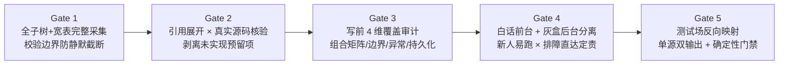

# 02 · AI 评测、源码对齐防幻觉与数值校准体系

## 零、15 秒总览：四项评测与校验对照

| 演进维度 | BEFORE（未治理基线） | AFTER（规格门禁与校准后） |
| :--- | :--- | :--- |
| **1. 五层卡池期望守恒与防摸包仿真** （[`run_gacha_box_sim.py`](./demo-simulation/run_gacha_box_sim.py) 可复现） | • 朴素随机：5,000 盒中 `31.3%` 空盒、`1/1` 唯一卡超发 `63` 张 • 尾包死保底：尾包出货占比飙至 `28.6%`（摸包漏洞），并拉高 `+28.7%` 隐性期望通胀 | 整盒保底 + Fisher-Yates 均匀洗牌 + 基础掉率补偿守恒 + `1/1` 全局耗尽锁： • 空盒 `0%`、单盒期望精确守恒 `1.10`、尾包占比回归均匀 `8.26%`、`mulberry32` 确定性复现 |
| **2. 长周期数值曲线校准** （[`run_sim.py`](./demo-simulation/run_sim.py) 可复现） | 旧版纯乘法衰减公式下： • 常规发布 40 轮后由 `890` 反跌至 `619`；连续 40 次破圈仍卡在 T0 • 爆发后高回落未设窗口上限 → 15 轮留存跌至 `21%` • 单一粉丝指标无法区分高社媒热度与强巡演实绩 | 引入保底增量与非线性衰减窗口上限后： • 5 条跨年成长轨道单调收敛（2 年 `2.1万` → 12 年 `8,890.8万` T5） • 用单维阈值重叠反例推演引出 **三支柱晋级门禁（粉丝 × 声望 × 实绩）** |
| **3. AI 批量生成测试用例** | 直接喂需求文档产出：过期废案与未落地规划混入、宽表截断，形式校验全绿却写出与代码相反的断言；执行列堆砌代码术语新人难跑 | 建立 **5-Gate 文档×源码核验 + 独立读回复审**：强制拆出「当前可测 / 未落地预留 / 跨文档冲突」，拆分为白话前台列 + 灰盒排查锚点列，配套导出格式基础自检（[`validate_csv.py`](./demo-simulation/validate_csv.py)） |
| **4. 多仓配置/导表排障** | 构建报错仅查最后提交人，因共用账号、批量导出覆盖与父类联动易误判源头 | 拆分为 **「人工漏操作 / 代码缺陷 / 工具缺防呆」** 三维度归因，推动工具侧补齐前置防呆 |

---

## 一、通用方法论 A：5-Gate 文档×源码防幻觉 QA 框架

### S · Situation（行业共性痛点）
在大型软件与游戏研发管线中，直接把需求文档喂给大模型生成测试用例几乎不可用：文档过期或含未开发规划、宽表拉取静默截断、忽略嵌入子文档导致漏测、用例要么全是代码术语（新人看不懂）要么过于泛化（出 Bug 无法定责）。同时，CI 导表与配置检查报错量大，传统人工只看最后提交人极易误判责任。

### T · Task（核心目标）
抽象一套**防 AI 幻觉、对齐真实实现、新人易执行且资深易排障**的通用测试用例与测试沙盒验收方法论，并配套 CI 配置异常的三维归因思路。

### A · Action（通用 5-Gate 方法论设计）
1. **以强制串行 5-Gate 替代“盲目 AI 批量产出”**
   - **Gate 1–2（全量采集 × 实现核验）**：强制核验文档完整性与嵌入引用，并对照实际实现把需求拆为三类——**当前可测 / 未落地预留隔离区 / 跨文档冲突清单**，从源头杜绝假 Bug。
   - **Gate 3（写前 4 维覆盖审计）**：强制展开状态互斥组合矩阵、边界异常与持久化场景，并绑定可执行验证锚点。
   - **Gate 4（前台白话 × 后台灰盒分离）**：执行步骤列零代码术语确保新人秒上手；排查辅助列内嵌定位锚点，提单即可直达定责。
   - **Gate 5（测试沙盒反向映射 + 单源双输出）**：由用例反推测试沙盒摆桩规格，脚本同源导出评审稿与导入表并通过格式/防重/乱码确定性门禁（配套脱敏示例表与格式校验脚本见下方 `validate_csv.py`）。
2. **闭环测试沙盒、引擎协议联动冒烟与 CI 三维归因思路**
   - 由核心用例反推隔离验收沙盒做闭环回归，避免在大地图/复杂环境中低效跑测；进一步打通 **「引擎 MCP 实机操控 + 服务端调试接口动态改参/跑后毫秒级自动回滚 + 坐标位移阈值断言 + 新增未知 Error 日志门禁 + 失败现场截图留证」** 的分钟级端到端自动化回归范式；
   - 将多仓配置/导出异常（含父类资产级联改动、孤儿配置与锁阻塞）从根源拆为「人工漏操作 / 代码缺陷 / 工具缺防呆」三类归因并去重催办，避免仅按最后提交人误追责。

### R · 通用工程价值
- 阻断过期废案与未落地规划混入测试集，显著降低 AI 用例的断言幻觉与漏先决风险；
- 形成从「文档审计 → 沙盒验收 → 格式门禁」的可复用通用方法论闭环。

---

## 二、案例 B：复杂 AI 规则系统的离线数值参数校准（STAR）

### S · Situation（背景与痛点）
在设计包含多变量成长曲线、衰减因子与多规则结算的长程 AI 模拟系统时，仅靠上线跑几轮看体感，很难提前发现长周期数值失衡（如静默衰减率叠加导致常规游玩反向缩水、或缺乏回落窗口上限导致爆发后断崖崩盘）。

### T · Task（核心目标）
把数值规则验收从人工体感升级为**可重复、零成本的确定性参数校准脚本**，在投入大模型联调前提前验证成长曲线单调性与边界稳态。

### A · Action（本人主导的关键动作）
1. **构建多策略成长曲线与衰减窗口扫描脚本**：同步覆盖 5 种行为策略、5 条 2–12 年成长轨道与 3 档爆发后回落敏感度（`L=0.003 / 0.05 / 0.10`）；
2. **基于校准输出逐项修正规则**：
   - 引入保底增量与档位曝光系数，修正旧版乘法公式在低基数阶段被静默衰减吞噬的问题；
   - 通过 3 档回落敏感度对照（15 轮留存 `97% / 47% / 21%`），锁定爆发后回落期上限为 3 轮；
   - 通过单维粉丝阈值在 4,000 万区间无法区分“高社媒热度”与“强巡演实绩”的定性反例推演，确立**三支柱晋级门禁（粉丝 × 声望 × 实绩）**；
   - 确立 **7 步确定性单轮结算顺序**，消除同轮多规则读写竞态。

### R · Result（可验证结果）
- 上线前定位并修正多类数值与结算竞态问题；校准脚本开源于 [`./demo-simulation/run_sim.py`](./demo-simulation/run_sim.py) 可本地复现。

---

## 三、可运行脚本与延伸细节索引

| 类型 | 脚本 / 文档路径 | 用途与运行方式 |
| :--- | :--- | :--- |
| **五层卡池期望守恒与防摸包仿真** | [`./demo-simulation/run_gacha_box_sim.py`](./demo-simulation/run_gacha_box_sim.py) | 5,000 盒三态概率对照：朴素随机 vs 尾包保底（暴露摸包漏洞与 `+28.7%` 期望通胀）vs 整盒保底 + Fisher-Yates 洗牌 + 基础掉率补偿守恒 + `1/1` 全局锁：`python 02-ai-eval-and-simulation/demo-simulation/run_gacha_box_sim.py` |
| **多策略成长曲线确定性校准脚本** | [`./demo-simulation/run_sim.py`](./demo-simulation/run_sim.py) | 复现旧乘法衰减曲线 vs 非线性校准曲线、回落窗口敏感度与单维阈值重叠反例：`python 02-ai-eval-and-simulation/demo-simulation/run_sim.py` |
| **导出表基础格式自检附件** | [`./demo-simulation/validate_csv.py`](./demo-simulation/validate_csv.py) | 对已入库只读示例 [`sample_testcases.csv`](./demo-simulation/sample_testcases.csv) 执行基础 UTF-8 BOM、列齐、ID 防重与乱码自检 |
| **上下文与 Token 审计** | [`./token-economics-audit.md`](./token-economics-audit.md) | Token 拆账与 Transformer U 型注意力上下文瘦身审计案例 |

### 附：上下文 U 型注意力实时 X 光透视（实机运行截屏 · 已脱敏）

针对 Transformer 长上下文的“中间迷失（Lost-in-the-Middle）”效应，在实机工作台内置逐条 X 光透视，直接可视化每段提示词/知识库/变量落点在左崖（0–12%）、中部谷底（12–85%）还是右崖（85–100%），并实时核算前置标签过滤拦截与状态折叠节省字数：

