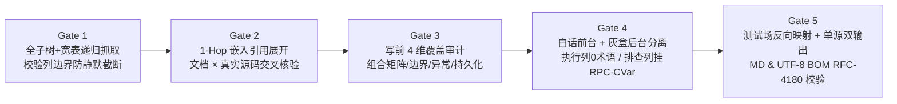

# 02 · AI 评测、源码对齐防幻觉与动态仿真压测体系

> **一句话价值**：解决大模型在生产 QA 与复杂状态机场景中的两大顽疾——**「脱离代码瞎编导致假 Bug / 漏测」** 与 **「规则数值在长周期运行后悄然死锁/失衡」**。本模块包含两套已落地的工程体系，以及可直接本地运行的零依赖 Python 校验 Demo。

---

## 一、5-Gate 文档×源码防幻觉 AI 测试用例工程管线（通用方法论）

传统“把需求文档丢给 ChatGPT 生成测试用例”在真实复杂项目里几乎不可用：文档过期、宽表被 API 截断、引用子文档漏读、代码里尚未实现的规划被写成用例导致大量假 Bug、新人看不懂代码术语而资深排查又缺定位锚点。

我将其重构为强制串行的 **5-Gate 防漏测工程管线**（已沉淀为可复用 Agent Skill）：



### 关键防幻觉与提效机制

| 门禁 | 解决的核心痛点 | 确定性工程约束 |
| :--- | :--- | :--- |
| **Gate 1–2：源码交叉核验** | AI 照着过期策划文档瞎编用例，把未开发功能提成假 Bug | 强制将需求拆为三类：**① 现网可测**、**② `[待开发/预留]` 隔离区**、**③ 跨文档冲突审计清单**（直接反馈研发/策划对齐）。 |
| **Gate 3：组合矩阵门禁** | AI 偷懒把多属性/多状态互斥矩阵压缩成一条泛化用例 | 强制展开等价类与边界组合表 + 历史高频缺陷转回归 + 强制绑定可执行锚点（场景 ID / 实体 ID / GM 命令）。 |
| **Gate 4：前后台视图分离** | 写太浅排障难，写太深新人看不懂 | **执行列**纯白话零代码类名（新人秒上手）；**排查列**内嵌 RPC ID、状态字段、CVar、控制台命令与日志 Tag（提单直达定责）。 |
| **Gate 5：单源双输出 + 确定性校验** | Markdown 评审稿与导入表格漂移、Windows 中文编码乱码/错列 | 反向映射标准测试场站点（`TP_QA_* \| QA_<Mod>_*`）；脚本单源输出 MD + UTF-8 BOM CSV，经 **RFC-4180 校验器**强检列数、重 ID、空必填与 `\uFFFD` 乱码。 |

### 商业项目脱敏落地实证（UE5 大型开放世界研发管线）

- **全量 AI 用例体系与 5-Gate 重构**：以 6 角色多 Agent 协作 + 实时文档源强校验补齐 **28 个核心模块 / 1,162 条用例** 并自动同步至多维表格双视图，提前暴露 **400+ 项策划需求缺口与口径冲突**；以核心 3C 模块为样板执行 5-Gate 源码交叉核验（17 子节点 + 4 篇 1-Hop 引用 × C++/C# 源码），拦截 **5 处跨文档冲突**、剥离 **4 项未落地预留功能防假 Bug**，重构 75 条双层用例（MD + RFC-4180 校验 CSV）。
- **测试场反向映射与 MCP 实机闭环**：由重构用例反推 **26 组场景摆桩规格**，结合 **Unreal MCP** 搭建闭环专用测试地图（37 Spawn / 333 场景资产包），将单图适用用例覆盖率由 **70.0% 提升至 98.6%**（**P0 冒烟覆盖率 74.2% → 100%**），实机验收反编译定位 2 个客户端隐藏真 Bug。
- **CI 导表/配置管线一键根因归因**：配套交付 **2,910 行零第三方依赖纯 Python 工具包**（含 `.uasset` 二进制父类链比对定位母蓝图缩放级联、P4 防误归因、孤儿配置/独占锁核验与多维表格去重催办闭环）。

*(注：以上为彻底脱敏的通用工程架构与实测相对量级，不含任何公司内部项目代号、源码或业务机密。)*

---

## 二、Prompt-as-Code 编译构建 + 500 轮动态数值/状态机仿真压测

在设计包含多变量成长曲线、衰减因子、概率触发与多规则结算的复杂 AI 规则系统时，**绝不靠“上线跑几轮看感觉”验收**——而是把规则工程化为 **编译管线 + 仿真压测套件**：

1. **模块化编译与校验管线**：`parse_rules.py → build_artifact.py → verify_schema.py → verify_regex.mjs` 实现源码与产物单一真源；
2. **500 轮（~10 年周期）动态仿真压测**：编写独立 Python 仿真器运行多场景轨迹，**在上线前一次性拦截 11 项系统级缺陷**，典型案例如下：
   - **冷启动永久死锁（Critical）**：纯乘法公式在初始值为 `0` 时恒输出 `0`，原参数跑满 10 年（500 轮）卡死在极低水位 → 引入最小保底增量与算法池上限校准；
   - **复合衰减率单位错误（High）**：静默流失率按 `-1.8%/轮` 累算导致年流失高达 **39%**，整条成长线崩盘 → 校准为 `-0.5%/轮` 并对回落期设置 3 轮上限防止归零；
   - **同轮多规则写入竞态（High）**：多条规则无明确先后导致判定读到旧值 → 建立 **7 步确定性单轮结算顺序**；
   - **跨文件悬空引用与中英文 Schema 键错配** → 全部由静态穿透检查脚本自动标红修复。

---

## 三、本地一键可运行 Demo（零第三方依赖）

本仓库在 [`./demo-simulation/`](./demo-simulation/) 下提供了两个完全脱敏、可直接运行的 Python 3 演示脚本：

1. **[`run_sim.py`](./demo-simulation/run_sim.py)**：复现「原参数冷启动死锁/过量衰减 vs. 校准后非线性成长模型」的 **500 轮动态仿真对比报告**；
2. **[`validate_csv.py`](./demo-simulation/validate_csv.py)**：Gate 5 确定性 CSV 门禁校验器（检查 UTF-8 BOM、RFC-4180 行列齐整、重复 ID、必填空值与非法替换字符 `\uFFFD`）。

```bash
python 02-ai-eval-and-simulation/demo-simulation/run_sim.py
python 02-ai-eval-and-simulation/demo-simulation/validate_csv.py
```

- **延伸阅读**：[Token 经济学与 Transformer U 型注意力上下文审计案例](./token-economics-audit.md)
