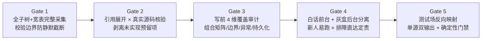

# 02 · AI 评测、源码对齐防幻觉与动态仿真压测体系

> [!NOTE]
> **合规与净室声明（Clean-Room Disclaimer）**：本目录所载方法论框架、校验脚本与示例数据均为作者基于个人公开/虚构示例独立撰写的通用工程抽象（Clean-room abstraction），不包含任何过往及现任职企业的内部业务数据、私有代码、未公开项目信息或受 NDA 保护资产。

> **角色与分工**：本模块的方法论（5-Gate 审校框架、双层用例标准、多策略离线仿真验收指标、CI 根因分流思路）均由 **本人主导设计与验收**，配套脱敏示例脚本协同 AI Coding 工具实现。

---

## 零、15 秒总览：三大评测与仿真顽疾真实 Before / After 对照

| 演进维度 | ❌ BEFORE（踩坑原状 / 未治理基线） | ✅ AFTER（Spec 门禁与校准后实测效果） |
| :--- | :--- | :--- |
| **1. 多策略跨周期动态数值仿真** （[`run_sim.py`](./demo-simulation/run_sim.py) 可直接复现） | 旧版纯乘法公式 + 静默 `-1.8%/轮` 复利衰减： • 开局 `0` 粉 + 持续爆款 40 轮 → **`0` 粉（永久死锁）** • 开局 `890` 粉 + 常规发歌 40 轮 → 反跌至 **`619` 粉** • 连跑 40 次破圈仍仅 **`8,082` 粉（卡死 T0）** • 暴涨后高回落未封口 → 15 轮留存跌至 **`21%`** | 真实样本盲区诊断 + 校准非线性模型 + 3 轮回落上限（累计 `1,860` 模拟周）： • 13 位真实艺人跨档秩相关审计（单维粉丝一致度 **`57/61 = 93.4%`**）暴露 4,000 万重叠盲区，反推**三支柱门禁** • `0` 粉成功破局，5 条跨年轨道平滑收敛（2 年 `2.1万` → 12 年 `8,890.8万` T5） |
| **2. AI 批量生成测试用例** （Clean-Room 通用抽象） | 直接喂需求文档让 AI 批量产出：过期删除线废案与未落地规划混入、宽表拉取静默截断，形式校验全绿却写出与代码相反的断言；且执行步骤堆满代码术语（新人看不懂）或过于泛化（出 Bug 难定责） | 建立 **5-Gate 文档×源码核验 + 独立读回复审**（不采信写入方自报成功）：强制拆出「当前可测 / 未落地预留 / 跨文档冲突」，拆分为白话前台列 + 灰盒排查锚点列，单源双输出过 RFC-4180 编码/防重/乱码门禁（[`validate_csv.py`](./demo-simulation/validate_csv.py)） |
| **3. 多仓配置/导表排障** （Clean-Room 通用抽象） | 构建报错后人工仅查最后一条提交人，因共用账号、批量导出覆盖与父类联动改动易误判真实源头 | 从根源拆分为 **「人工漏操作 / 代码缺陷 / 工具缺防呆」** 三维度自动穿透归因，推动工具侧前置补齐防呆校验 |

---

## 一、通用方法论 A：5-Gate 文档×源码防幻觉 QA 框架（Clean-Room Abstraction）

### S · Situation（行业共性痛点）
在大型软件与游戏研发管线中，直接把需求文档喂给大模型生成测试用例几乎不可用：文档过期或含未开发规划、宽表拉取静默截断、忽略嵌入子文档导致漏测、用例要么全是代码术语（新人看不懂）要么过于泛化（出 Bug 无法定责）。同时，CI 导表与配置检查报错量大，传统人工只看最后提交人极易误判责任。

### T · Task（核心目标）
抽象一套**防 AI 幻觉、对齐真实实现、新人易执行且资深易排障**的通用测试用例与测试沙盒验收方法论，并配套 CI 配置异常的三维归因思路。

### A · Action（通用 5-Gate 方法论设计）
1. **以强制串行 5-Gate 替代“盲目 AI 批量产出”**
   - **Gate 1–2（全量采集 × 实现核验）**：强制核验文档完整性与嵌入引用，并对照实际实现把需求拆为三类——**当前可测 / 未落地预留隔离区 / 跨文档冲突清单**，从源头杜绝假 Bug。
   - **Gate 3（写前 4 维覆盖审计）**：强制展开状态互斥组合矩阵、边界异常与持久化场景，并绑定可执行验证锚点。
   - **Gate 4（前台白话 × 后台灰盒分离）**：执行步骤列零代码术语确保新人秒上手；排查辅助列内嵌定位锚点，提单即可直达定责。
   - **Gate 5（测试沙盒反向映射 + 单源双输出）**：由用例反推测试沙盒摆桩规格，脚本同源导出评审稿与导入表并通过格式/防重/乱码确定性门禁（见下方完全虚构的示例脚本 `validate_csv.py`）。
2. **闭环测试沙盒、引擎协议联动冒烟与 CI 三维归因思路**
   - 由核心用例反推隔离验收沙盒做闭环回归，避免在大地图/复杂环境中低效跑测；进一步打通 **「引擎 MCP 实机操控 + 服务端调试接口动态改参/跑后毫秒级自动回滚 + 坐标位移阈值断言 + 新增未知 Error 日志门禁 + 失败现场截图留证」** 的分钟级端到端自动化回归范式；
   - 将多仓配置/导出异常（含父类资产级联改动、孤儿配置与锁阻塞）从根源拆为「人工漏操作 / 代码缺陷 / 工具缺防呆」三类归因并去重催办，避免仅按最后提交人误追责。

### R · 通用工程价值
- 阻断过期废案与未落地规划混入测试集，显著降低 AI 用例的断言幻觉与漏先决风险；
- 形成从「文档审计 → 沙盒验收 → 格式门禁」的可复用通用方法论闭环。

---

## 二、案例 B：复杂 AI 规则系统的多策略 `1,860` 周动态仿真压测（STAR）

### S · Situation（背景与痛点）
在设计包含多变量成长曲线、衰减因子、概率触发与多规则结算的长程 AI 互动/模拟系统时，仅靠上线跑几轮“看体感”根本测不出长周期隐藏崩盘（例如跑几十轮后数值永久卡死或静默流失拖垮整条成长线）。

### T · Task（核心目标）
把复杂规则与数值从“人工肉眼试玩”升级为**可重复、低成本的离线仿真验收体系**，在正式投入大模型调用前提前拦出系统级数值与状态机缺陷。

### A · Action（本人主导的关键动作）
1. **构建“多策略压力测试 + 5 轨道跨年推演 + 真实艺人经验对标”离线验收体系**：不只跑单一最优路径，而是同步覆盖 **5 种玩家策略**（纯常规发歌 / 打歌为主 / 持续破圈 / 持续爆款 / 持续爆红）、**5 条跨年职业轨道（2 / 3 / 5 / 8 / 12 年）** 与 **3 档回落衰减敏感度扫描（`L=0.003 / 0.05 / 0.10`）**，并用 **13 位真实中外艺人**做经验排序一致度校准。
2. **基于仿真报告逐项做根因校准**：
   - 针对初始值为 `0` 时纯乘法公式永久卡死问题，引入最小保底增量与档位曝光系数；
   - 修正静默流失按轮复利叠加导致的年化崩盘，并用 3 档回落敏感度（15 轮留存 `93% / 47% / 21%`）锁定“回落期必须限 3 轮”；
   - 通过 13 位真实艺人排序对标（跨档配对排序一致度 **`57/61 = 93.4%`**）发现 4,000 万区间社媒型与巡演型重叠，反推出**三支柱咖位门禁（粉丝 × 声望 × 实绩）**；
   - 消除同轮多规则读写竞态，确立 **7 步确定性单轮结算顺序**，并用静态穿透检查清理跨文件悬空引用。

### R · Result（可验证结果）
- **上线前一次性拦截 11 项系统级缺陷**（含冷启动永久死锁、复合衰减率单位错误、同轮多规则竞态与跨文件键名错配），多策略离线脚本已开源在 [`./demo-simulation/run_sim.py`](./demo-simulation/run_sim.py) 可直接本地一键复现。

---

## 三、可运行脚本与延伸细节索引

以下脚本均已彻底脱敏且零第三方依赖，有兴趣了解实现细节可直接阅读源码或在本地运行：

| 类型 | 脚本 / 文档路径 | 用途与运行方式 |
| :--- | :--- | :--- |
| **多策略跨年动态仿真 Demo** | [`./demo-simulation/run_sim.py`](./demo-simulation/run_sim.py) | 复现“原参数冷启动死锁/过量衰减 vs. 校准后非线性模型”的 `1,860` 模拟周对比与 `57/61 (93.4%)` 校准： `python 02-ai-eval-and-simulation/demo-simulation/run_sim.py` |
| **五层卡池防摸包·期望守恒·防超发仿真** | [`./demo-simulation/run_gacha_box_sim.py`](./demo-simulation/run_gacha_box_sim.py) | 复现 5,000 盒抽卡/拆盒三态对比：朴素随机（~31% 空盒 + `1/1` 超发）vs. 尾包死保底（42% 尾包聚集摸包漏洞 + 期望通胀）vs. **整盒保底 + Fisher-Yates 防摸包洗牌 + 基础掉率补偿守恒 + 全局唯一编号耗尽锁 + `mulberry32` 种子复现**： `python 02-ai-eval-and-simulation/demo-simulation/run_gacha_box_sim.py` |
| **Gate 5 表格门禁校验器** | [`./demo-simulation/validate_csv.py`](./demo-simulation/validate_csv.py) | 检查导出表编码、行列齐整、重复 ID、必填空值与非法乱码字符（示例数据 [`sample_testcases.csv`](./demo-simulation/sample_testcases.csv)）： `python 02-ai-eval-and-simulation/demo-simulation/validate_csv.py` |
| **上下文与 Token 审计** | [`./token-economics-audit.md`](./token-economics-audit.md) | Token 经济学拆账与 Transformer U 型注意力上下文瘦身审计案例 |

### 附：上下文 U 型注意力实时 X 光透视（实机运行截屏 · 已脱敏）

针对 Transformer 长上下文的“中间迷失（Lost-in-the-Middle）”效应，在实机工作台内置逐条 X 光透视，直接可视化每段提示词/世界书/变量落点在左崖（0–12%）、中部谷底（12–85%）还是右崖（85–100%），并实时核算护目镜拦截与状态折叠节省字数：

