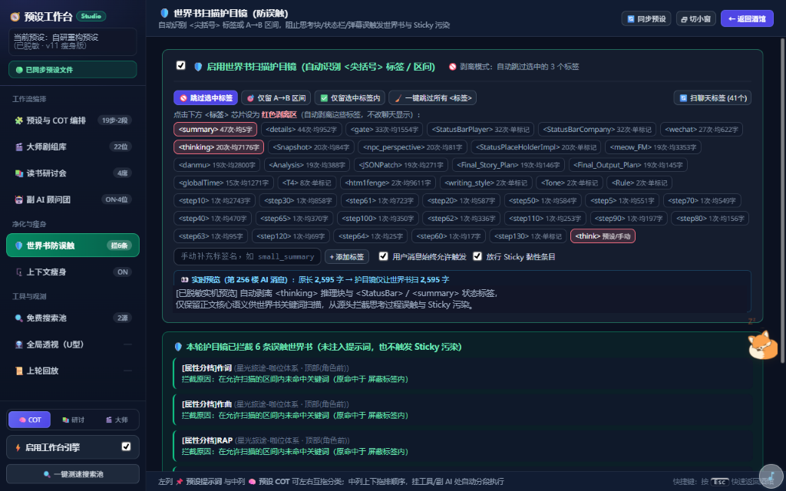

# 03 · 确定性护栏武器库与协作质量治理

> **核心工程原则**：**「范围与判据先行、单一权威；机制保执行确定性，语义判断降级为可读状态，让模型读而非算。」**  
> **角色与分工**：本模块所有护栏机制设计、异常边界定义、遗留系统重构方案及复审红队框架均由 **本人主导拍板与验收**，脚本与测试代码协同 AI Coding 工具实现（只展示 Spec 解题思路与真实 Before / After 效果，不公开可照抄的成品业务源码）。

---

## 零、15 秒总览：五大确定性治理真实 Before / After 对照

| 治理维度 | ❌ BEFORE（踩坑原状 / 依赖模型自觉） | ✅ AFTER（确定性护栏与 Spec 治理落地） |
| :--- | :--- | :--- |
| **1. 随机判定与防作弊** | Prompt 让模型“随机掷 1–100”，模型按剧情氛围暗箱挑顺眼点数（总贴着惊险过关），且用户重生成可无限 SL 刷点 | 生成前由 `crypto.getRandomValues` 真随机预生成并按消息 `ownerKey` 锁定（重生成强制复用防 SL），响应后正则反向核验防模型暗改骰值并告警 |
| **2. 隐式偏好挖掘与记忆** | 直接拿整段聊天记录总结用户偏好，AI 把“虚构角色人设台词”误当成“真用户的爱好”，且长期追加偏好撑爆上下文 | 后台评估器物理隔离「系统内容 / 角色台词 / 真实用户输入」，仅以真实输入取证写结构化黑白名单；触达双阈值自动触发两级原地凝练压缩 |
| **3. 禁令黑名单 vs 换轴公理** | `862 字` 散乱打地鼠禁令（严禁顺从 / 严禁套路 A/B/C），越堆越触发粉红大象效应，反向把 NPC 逼成无理杠精 | 彻底删除症状黑名单，重构为 **3 条第一性公理**（世界独立 / 主体真实 / 因果守恒），先独立确定客观事实与角色立场再推演交互 |
| **4. 开源遗留前端收敛** | 5 套割裂管线并行、全局同名 DOM ID 绑定隐藏层致设置开关点不动、未转义 `</textarea>` 击穿 DOM、跨渠道消息串台、0 自动化测试 | **5 管线合一**、启动核心模块 **`8 → 4`**、`@scope` CSS 隔离与 HTML 转义根治串台与死控件，从 0 建立 **36 套自动化测试全绿** |
| **5. 验收环境与复审门禁** | 空壳 Mock 测试制造一堆真机根本不存在的假缺陷；单 Agent“自己写、自己测、自己宣布通过”漏放异步竞态 Bug | 确立 **「完整字节副本 + 独立端口 + 付费 API 出站拦截」** 零污染真机验收规范；引入 Builder × Read-Only Reviewer 双盲审计（95 文件起止哈希锁定，查出 9 项工程缺陷与 10 个可执行反例） |

---

## 一、四大确定性护栏模式（STAR 精炼）

大模型擅长语义理解与叙事表达，但天然不擅长**公平随机、严格语法闭合、跨轮记忆保真**。与其写数千字 Prompt 反复求模型“千万别犯错”，不如用确定性机制锁死边界：

| 护栏模式 | S / T（解决的顽疾） | A（确定性机制设计） | R（落地效果） |
| :--- | :--- | :--- | :--- |
| **1. 真随机防作弊护栏** | 要求模型“随机掷 1–100”时，模型会按语境“暗箱挑顺眼的数”，且重生成可反复刷骰 | 在生成前由真随机源预生成唯一锁定点数；同一条消息重试/重生成强制复用同一组锁定值；响应后自动核验输出点数是否在合法集合内 | 堵死模型暗箱挑数与用户“刷骰子”漏洞，概率判定完全可审计 |
| **2. 嵌套语法检测与自动修复** | 复杂模板与状态变量偶发出现多层未解析语法泄漏到前端界面 | 被动监听响应，经平衡括号词法扫描捕获任意层级残留标签并去重，组装上下文调用独立接口定向修复，且凭据隔离存储、纯文本安全回填 | 自动兜底界面渲染异常，同时杜绝敏感配置明文落盘与注入风险 |
| **3. 异步偏好挖掘与两级记忆压缩** | 长对话中用户真实偏好会漂移，全量塞入上下文爆 Token，单次粗压缩又丢细节 | 后台独立评估器**严格隔离“系统内容 / 虚构人设 / 真实用户输入”**，仅以真实输入提炼结构化偏好写黑白名单；触达双阈值自动原地凝练压缩并回注 | 长程体验持续贴合用户真实口味，兼容推理模型输出并防止上下文无限膨胀 |
| **4. 换轴判据替代黑名单** | “严禁出现 A/B/C”类症状黑名单越堆越长，触发粉红大象效应且易被换词绕过 | 删除零散禁令，改为正向运行机制与结构化因果判据，让模型先独立确认事实与立场再推演交互 | 实战中将 **862 字散乱打地鼠补丁精简为 3 条第一性公理**，稳定性显著提升 |

### 实机确定性护栏截屏：世界书扫描护目镜（防 `<thinking>` / 状态标签误触 · 已脱敏）

确定性词法过滤在请求发往模型前自动识别 41 个结构标签，剔除思考块与状态栏噪声，只让世界书扫描器读取正文核心语义。下图为真实长程存档第 256 楼的实机拦截现场——单轮拦下多条仅在屏蔽标签内偶然命中关键词的误触条目，从源头阻断 Sticky 级联污染：



### 核心亮点代码切片：思维链与正文双钩子物理隔离盾（[`thinking-regex-shield`](https://github.com/feng46430-cloud/thinking-regex-shield) · 独立开源仓 · 82/82 测试全绿）

**痛点**：在渲染管线中，全局/预设/角色卡正则经常误匹配到 `<thinking>...</thinking>` 内部引用的关键词或尖括号，导致思维链被改坏、页面 HTML 击穿，甚至流式生成中途闪崩。

```javascript
// 1) BEFORE_REGEX (EARLIEST)：只藏“内体”、保留外标签，兼容闭合 / prefill / 流式未闭合三态
const CLOSED_PAIR_RE    = /^([\s\S]{0,160}?<(think(?:ing)?)>)([\s\S]*)(<\/\2>)/i;
const CLOSED_ONLY_RE    = /^([\s\S]+)(<\/think(?:ing)?>)/i;
const STREAMING_OPEN_RE = /^([\s\S]{0,160}?<(think(?:ing)?)>)([\s\S]+)$/i;

function beforeRegexHook(mes, ctx) {
  if (!mes || (ctx && (ctx.isUser || ctx.isSystem || ctx.isReasoning))) return mes;
  if (stash.size > 32) stash.clear(); // 防下游异常中断管线造成 Map 泄漏的保险丝

  const m = CLOSED_PAIR_RE.exec(mes) || STREAMING_OPEN_RE.exec(mes);
  if (!m) return mes;
  const id = String(++seq);
  stash.set(id, m[3]); // 仅暂存思维链内体，外层 <thinking></thinking> 原样保留
  return m[1] + `THSHIELDTOKEN${id}END` + (m[4] || '') + mes.slice(m[0].length);
}

// 2) AFTER_MARKDOWN (LATEST, before DOMPurify)：按 <textarea> 内外分治安全还原
function afterMarkdownHook(mes) {
  if (stash.size === 0 || !mes.includes('THSHIELDTOKEN')) return mes;
  // 先在 <textarea> 内还原（保留原始换行符，绝不插 <br>）
  let out = mes.replace(/(<textarea\b[^>]*>)([\s\S]*?)(<\/textarea>)/gi, (full, o, body, c) =>
    body.includes('THSHIELDTOKEN') ? o + body.replace(TOKEN_SCAN_RE, restoreRaw) + c : full
  );
  // 再还原普通 DOM 区域（HTML 转义防 XSS + 换行转 <br>）
  return out.replace(TOKEN_SCAN_RE, (_, id) => escapeHtml(stash.get(id)).replace(/\r?\n/g, '<br>'));
}
```

**为什么这么设计？（4 个关键工程取舍）**
1. **“留壳藏芯”兼容生态**：故意保留外层 `<thinking></thinking>` 标签、只把内体替换成惰性纯字母占位符 `THSHIELDTOKEN<id>END`，这样既让外部美化正则照常匹配渲染折叠盒，又让全局/角色正则完全碰不到思考正文里的任何字符；
2. **贪婪匹配末闭合标签 + 三态覆盖**：`CLOSED_PAIR_RE` 刻意用贪婪 `[\s\S]*` 吃到最后一个闭合标签，确保思考正文里自己讨论并引用 `</thinking>` 时不会提前截断击穿护盾；同时覆盖 Prefill 缺开标签与流式吐字未闭合态；
3. **`<textarea>` 内外分治防 XSS 与乱行**：`<textarea>` 内把 `\n` 换成 `<br>` 会直接把源码打印成乱码，普通节点不转义又会遭 HTML 注入，因此分两趟精准还原；
4. **32 条保险丝防静默泄漏**：若任意第三方插件在 `BEFORE_REGEX` 与 `AFTER_MARKDOWN` 之间抛错中断管线，定长清理兜底避免内存缓慢泄漏。

---

## 二、遗留前端改造与自动化测试门禁（基于开源二次开发 · STAR）

> **归属声明**：本案例为基于第三方大型开源前端扩展进行的**架构诊断、收敛重构与自动化测试建设**。遵循原作者版权协议，本仓库不放任何第三方源码，仅呈现本人主导的改造方案与验收结果。

### S · Situation（背景与痛点）
接手二次开发的开源前端体量庞大、核心逻辑高度集中在超巨型单文件中，存在多份分叉转义函数、页面注入破坏风险、多平台共享视图导致的控件 ID 冲突失效，以及跨渠道消息串台等顽疾，且完全缺乏自动化测试保护。

### T · Task（核心目标）
在不破坏上游同步能力的前提下，消除高危串台与失效控件，降低资源体积与启动负担，并从 0 补齐可重复执行的自动化质量门禁。

### A · Action（本人主导的关键动作）
1. **先体检定根因，再收敛架构**：梳理出重复分叉逻辑、未转义节点与全局 ID 冲突清单，制定改造优先级；
2. **多管线合一与样式/资源治理**：将 5 套割裂的处理管线收敛为单一真源并增加离线降级，在管线期直接拦截副作用以根治跨渠道串台；推动启动模块懒加载、图片资源无损/有损压测瘦身与自定义样式作用域隔离；
3. **从 0 建立自动化回归门禁**：确立滤网解析、防串台、提示词契约、主动流程与端到端冒烟五类测试边界，同步规范维护与上游仓库的定期合并策略。

### R · Result（可验证结果）
- **体验与架构收敛**：5 套割裂管线合一，启动核心模块由 **`8 → 4`**，彻底解决多渠道串台与死控件问题；
- **质量门禁闭环**：累计交付 **36 套自动化测试全绿**（覆盖滤网解析、防串台、提示词校验、主动流程及浏览器端到端验证），迭代回归可快速验真；同时纠偏“空壳 Mock 制造假缺陷”反模式，确立 **「完整字节副本 + 独立端口 + 付费 API 出站拦截守卫」** 零污染真机验收规范，并完成 95 文件起止哈希锁定的工程 × UX 双盲审计。

---

## 三、协作治理与延伸规范索引

| 文档 / 体系 | 说明 |
| :--- | :--- |
| **[双 Agent 交叉复审工作流（Builder × Read-Only Reviewer）](./dual-agent-review-sop.md)** | 禁止“自己写、自己测、自己宣布通过”的独立只读复审 SOP（曾拦截异步竞态与异常卡死回滚缺陷） |
| **[13 维红队系统/代码评审记分框架](./13-dim-redteam-rubric.md)** | 通用脱敏版红队评审打分标准，用于上线前结构化排雷 |
| **双机防冲突同步与交接规范（`agy-sync`）** | 个人项目与工具配置的增量防冲突双向同步方案，内置工作区与敏感凭据硬隔离及 `HANDOFF.md` 接力规范 |

---

> 💡 **注（7:3 知识产权与面试演示声明）**：为保护原创工具与规则资产免受自动化爬虫滥用，本仓库公开核心架构原理、代表性高亮代码切片与验收门禁规范；完整的确定性护栏扩展套件（含真随机防篡改、异步偏好压缩、词法修复与 36 套回归用例）支持于业务面试中**现场屏幕共享实机演示与任意极端 Case 当场压测**。
