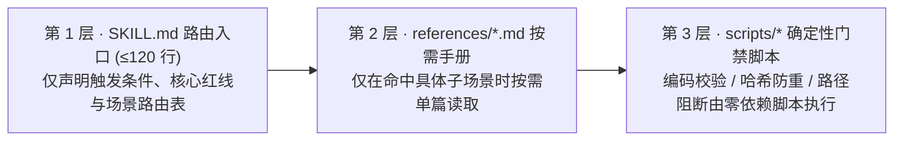

# 生产级渐进式披露 Agent Skills 与按需 MCP 安全准入治理（Clean-Room 概览）

> [!NOTE]
> **合规与净室声明（Clean-Room Disclaimer）**：本文展示作者自建 Agent Skills 体系与 MCP 工具准入治理的**通用架构范式与脱敏设计规格**，不包含任何企业内部文档、内网地址、私有凭据或受 NDA 保护信息。

---

## 一、为什么用「渐进式披露（Progressive Disclosure）」替代全量塞文档？

在复杂研发、评测与内容生产管线中，若将上百篇框架手册、API 签名与历史踩坑一次性塞进常驻 System Prompt，会同时触发三大顽疾：
1. **常驻 Token 账单失控**：每轮对话白白消耗数万无关规则 Token，且极易污染前缀缓存；
2. **中间注意力稀释（Lost-in-the-Middle）**：90% 未命中的边缘条款挤占核心指令权重，导致关键门禁漏执行；
3. **规则与校验脚本脱节**：纯文本 SOP 依赖模型“自觉遵守”，缺乏确定性代码门禁兜底。

### 三层渐进式披露标准结构



---

## 二、自建 7 套生产级 Agent Skills 矩阵（消化 160+ 篇技术文档）

| 技能模块（脱敏代称） | 核心解决痛点 | 渐进式结构与确定性兜底机制 |
| :--- | :--- | :--- |
| **1. `qa-testcase-authoring`**<br>（5-Gate 用例防幻觉审计） | 直接喂文档让 AI 写用例易混入废案/未落地规划，且术语黑话新人难执行 | 串行强制过 5 道门禁（全量宽表防截断 → 源码核验剥离未实现预留 → 四维覆盖矩阵 → 白话前台×灰盒锚点分离 → 单源双输出过 RFC-4180 校验脚本） |
| **2. `ci-config-triage`**<br>（多仓配置三维根因归因通用范式） | 多仓构建报错仅盯最后提交人极易冤枉人（父类级联改动 / 删资产留孤儿配置 / 锁冲突） | 穿透双仓提交链追查真实源头，按「人工漏操作 / 代码缺陷 / 工具缺防呆」三维归类并幂等去重入库、跨天未修自动催办 |
| **3. `mcp-on-demand`**<br>（四级按需 MCP 安全准入） | 盲目预装数十个闲置 MCP 拖慢启动、占用工具槽位并引入第三方供应链风险 | 确立四级决策树：已挂载优先 → 官方受管插件市场 → 官方 Registry 零依赖检索脚本 → 协议兼容与本机凭据隔离安全门禁 |
| **4. `agy-sync`**<br>（双端三方防冲突同步与防泄密） | 多设备高频协同易互相覆盖进度，或误将工作区文档/本地 API 密钥同步上云 | 基于 SHA-256 基线账本做三方增量同步（双改自动无损分叉 `.conflict-*`），并在路径解析层**代码级硬拦截工作区目录与密钥文件** |
| **5. `interactive-narrative-kb`**<br>（93 篇宿主架构渐进式知识库） | 长程互动系统的提示词拼装顺序、世界书递归/绿灯冷却与多模型采样参数极易配错 | 将 93 篇官方文档拆为 9 张专题按需手册 + 标准世界书/隐藏标签正则配方模板，日常常驻接近零占用 |
| **6. `sandbox-ui-runtime`**<br>（68 篇前端沙箱与状态变量手册） | 嵌入式 iframe UI 易出现流式未闭合闪屏、7 层变量作用域串台或 DOM 泄漏 | 按需路由变量 Schema 校验、YAML 精简注入（`$` 前缀私有键自动过滤不发给 AI）与页面销毁生命周期清理模板 |
| **7. `evidence-to-ats-pipeline`**<br>（苏格拉底证据挖掘与印刷门禁） | AI 润色文档易编造虚假指标或叠堆空洞黑话，且导出 PDF 易跨页孤行 | 强制锁定 `[Verified]` 事实库零杜撰，配套违禁词扫描、外链合规校验与无头浏览器固定页数渲染门禁 |

---

## 三、`mcp-on-demand` 四级安全准入决策树与凭据边界

1. **Tier 0（零新增开销）**：优先调用已挂载的引擎/版本控制/文档 MCP，严禁绕道写脆弱的临时爬虫或 Shell 拼接；
2. **Tier 1（官方受管集成）**：检索官方插件目录，优先采用带原生 OAuth 隔离的官方插件；
3. **Tier 2（上游权威源检索）**：通过零依赖脚本直查官方 MCP Registry 与上游开源仓，拒绝来历不明的二道中转包装或收费代理；
4. **Tier 3（协议与数据边界红线）**：
   - 仅放行标准本地 `stdio` 或受控 `streamable-http`；
   - **密钥物理留本机**：一切 Token / API Key 仅允许写入被同步器硬排除的本机私有配置或系统环境变量，严禁进入任何跨端同步目录。

---

## 四、`agy-sync` 代码级数据边界硬隔离切片（防泄密不靠自觉）

在跨设备 AI 协同工作流中，“提醒自己别传错文件夹”迟早会出错。因此直接在同步引擎入口放置不可绕过的路径断言与凭据黑名单：

```javascript
const EXCLUDE_SECRET_PATTERNS = [
  'auth.json', 'secrets.json', 'cookie-secret.txt', '.env'
];
const EXCLUDE_EXTENSIONS = ['.key', '.pem', '.p12', '.secret', '.log', '.bak'];

function assertNotWorkPath(dirPath) {
  const normalized = path.resolve(dirPath).replace(/\\/g, '/').toLowerCase();
  if (/(^|\/)(work|workspace)(\/|$)/.test(normalized)) {
    throw new Error(`SAFETY BLOCK: Refusing to sync work directory "${dirPath}" to personal cloud.`);
  }
}
```
