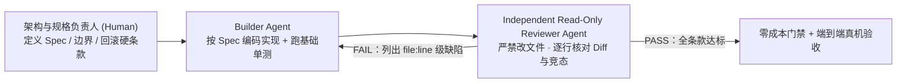

# 双 Agent 交叉复审工作流（Builder × Independent Read-Only Reviewer）

> **核心问题**：AI Coding 时代最大的质量风险，不是 AI 写不出代码，而是 **“同一个 Agent 既写代码又自测自夸，把异步竞态、破坏性回归和不可回滚改动悄无声息地塞进主干”**。

---

## 工作流架构（三权分立门禁）

---

## 实战案例：1.7 万行前端启动性能优化（P0 三刀重构 · 4 轮交叉复审）

- **改造目标**：将应用启动核心模块加载数从 **`8 → 4`**（Prompt / TTS / Image / Worldbook 全部改造为 `ensure*Manager` 懒加载 + 缓存）。
- **设立的硬性验收条款**：
  1. 绝不破坏既有公共 API getter；
  2. 所有异步懒加载回调不得引入用户交互竞态；
  3. 每一项优化必须保留可独立回滚快照。
- **4 轮独立只读复审真实拦出的高危缺陷**：
  - **Round 1（拦截 4 处 FAIL）**：暴露出公开 getter 导出缺失与初始化顺序依赖；
  - **Round 2（拦截 3 处 P2）**：在 `calendar-view.js` 抓出**开关回调竞态 Bug**——用户快速切换开关时，异步懒加载完成后的初绘回调会覆盖用户刚刚的点击状态 → 在 `change` 回调首行打标 `e.target.dataset.userTouched='1'` 并在补绘前校验，消除了该类状态覆写复现；
  - **Round 3–4（风险留痕）**：审计出三刀缝在同一文件导致“每刀独立回滚”未严格闭环，留痕目录基线校验点后才放行合并。

---

## 零成本门禁优先准则（Cost-Aware Verification）

为了避免频繁调付费大模型烧预算，每次迭代按两级顺序验收：
1. **Tier 1（零 Token 成本，必须先全绿）**：静态语法检查、Schema/Manifest 契约校验、单元测试、假模型冒烟（`smoke --fake`）、异常边界与提示词组装预览；
2. **Tier 2（产生模型费用，仅在 Tier 1 全绿后按需触发）**：真实 LLM 端到端冒烟与人工抽检。

## 隔离副本真机验收原则

针对“空壳 Mock 环境制造假缺陷”的问题，验收环境采用完整副本 + 独立路径与端口运行，仅在出站层拦截付费模型请求（不破坏宿主正常启动），避免把 Mock 环境缺陷误判为真实产品 Bug。

