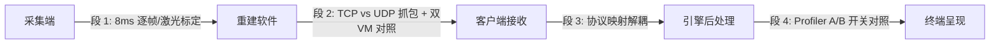

# 04 · 端到端延迟控变量拆解、研发分支治理与底层根因排障

本模块记录游戏质量工程（QA Lead）与底层排障过程中沉淀的系统工程基本功——**多段延迟控变量拆解、协议级抓包定责、跨平台并发/哈希排障与多分支验收治理**，这些排查方法与 AI 系统的端到端延迟定位和质量门禁直接同源。

---

## 1. 全链路端到端延迟 4 段控变量拆解

面对横跨「数据采集 → 重建软件 → 传输协议 → 客户端引擎后处理」的端到端延迟黑盒，凭主观体感无法区分主瓶颈所在：
- **分段隔离测量**：拆分为 4 段独立可测区间，结合同机双虚拟机有线/无线对照、8 ms 高速逐帧与激光触发标定起止点；
- **引擎 Profiler A/B 证伪与协议抓包**：用 Unity Profile Analyzer 开关对照排除客户端后处理怀疑（实测后处理帧开销极低），锁定主耗时在传输段；抓包对比 TCP 与原始 UDP 路径，定位到原始 UDP 跳过握手导致固定魔数 `actorId` 映射失效，修正协议映射后打通直测链路。

---

## 2. 多分支研发防返工治理与引擎单机多端直测

- **9 周分支验收节奏**：针对开发分支不稳定时过早关单导致主干合入冲突与返工无追踪，推动落地「开发分支冒烟 → 周迭代合入 → 封版 → QA 统一主干/发布分支验收」流程，保障大型跨国虚拟赛事稳定完赛。
- **引擎内单机多端直测**：将需要多人多台设备联调的手工冒烟，推动改造为引擎内单机模拟裁判与多选手端直测，把单次冒烟从多人 20–30 分钟压到单人 5–10 分钟。

---

## 3. 精选 5 大底层工程根因排障复盘

详单见 [**`engineering-postmortems.md`**](./engineering-postmortems.md)，涵盖：
1. **协议层**：原始 UDP 无握手跳过初始化导致魔数 `actorId` 映射失效；
2. **操作系统并发层**：V1 单测 `rewind` 1/12 概率失败 → 定位为 Windows `tmp+rename` 原子写与文件索引锁冲突触发 `EPERM`；
3. **跨平台 CI 层**：修改 3 个文件却报全仓 60 文件变更 → 定位为 `core.autocrlf=true` CRLF vs 基准 LF 哈希错配；
4. **多 Agent 可观测性层**：流水线降级只报 `"pipeline failed"` → 补齐前置异常捕获与精确 `stepId` 追踪；
5. **前端 DOM 与状态层**：全局同名 DOM ID 绑定隐藏层与 `</textarea>` 未转义串台修复。
