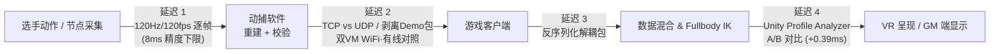

# 04 · 软硬件全链路控变量评测与研发流程治理

> **一句话价值**：在切入 AI 工程之前，我已通过 6 年一线游戏与 XR 复杂系统（育碧 / 腾讯内包 / 中手游外包 Leader / 英雄体育 QA Lead）锤炼出扎实的方法论——**多段延迟拆解、控变量实验设计、多架构量化 Benchmark、研发分支治理与内部工具产品化**。这与今天做 **AI Eval / Agent 质量工程** 底层完全同源。

> **完整公开 PDF 原件（免登录直阅）**：[飞书作品集《测试文档》](https://jcn3qpi51ul0.feishu.cn/drive/folder/Lj6cfpcyzluJ6Bd5zq1cfjw0nTd)（含 23 页延迟方案、16 页硬件横评总结、9 周研发流程梳理、2 份工具 PRD 与游戏系统策划探索）。

---

## 一、VR 动捕全链路 4 段延迟拆解与控变量实验设计（23 页方案）

在虚拟跆拳道全球赛事项目（VTKD）中，端到端体感延迟直接决定竞技公平性与选手眩晕体验。我从 0 梳理出可独立测量的 **4 段延迟链路**：

- **排除人工与器材变量干扰的实验装置**：评估 3 机位误差与单机位对焦局限后，敲定 **单机双虚拟机（VM A 走 WiFi / VM B 走有线）同步对照方案**，结合 **可调速电动转盘 + NH72A 计数器（霍尔磁感应 / 激光反射）** 及真人 **双激光对射传感器** 精确标定动作起止点；
- **代码与协议级排障**：实测定位第三方动捕（诺亦腾）Unity SDK 原始 UDP 失败根因——**原始 UDP 跳过 TCP 初始化导致返回十进制魔数 `actorId`**，通过映射索引 `0, 1...` 打通采集；使用 **Unity Profile Analyzer** 对比开关 `FullbodyIK` 帧开销（`0.54ms` vs `0.93ms`，差值 `+0.39ms`），并精准拆出分段预算（如 AXIS `Node→Software 110±10ms`、`VR→GM 60±10ms`）。

---

## 二、3 架构 × 6 设备 × 7 维度硬件横评与选型拍板（16 页总结）

| 动捕架构 | 评测设备 | 实测平均延迟 | 5 分钟/10 组强磁场累积误差压测 | 分场景选型结论 |
| :--- | :--- | :---: | :--- | :--- |
| **光学动捕** | VICON | **`43.8ms`**（33–66ms） | 光学不受磁干扰 | 正式国际大赛性能最优（结合低成本光捕合作评估） |
| **惯性穿戴** | AXIS | **`53.5ms`**（50–67ms） | 第 1 组（30s）即明显偏移，后续未继续恶化 | 适合日常训练或配合赛事校准流程管理 |
| **惯性穿戴** | 诺亦腾（关脚锁） | **`112.8ms`**（100–133ms） | 前期可接受，`3'30"` 后劣化至不可接受 | 佩戴舒适度佳但延迟 >100ms 且强磁易掉线 |
| **惯性穿戴** | 虚拟动力（关脚锁） | **`198.1ms`**（166–250ms） | 抗磁最佳，`4'30"` 仅轻微偏移 | 延迟过高淘汰 |
| **视觉动捕** | 迪迈 / CY | **`>100ms` / `>200ms`** | 视觉不受磁干扰（HMD 补偿位移） | 迪迈为低成本 toC 备选；CY 识别失效淘汰 |

- **最终业务决策**：综合**精准性、延迟率、稳定性**及不同节点数量穿戴方案评估结果，最终推动项目拍板采用**核心 5 节点（双臂、双腿、胸）穿戴式动捕方案**。

---

## 三、9 周分支发布治理、656 用例架构与内部提效工具 PRD

1. **研发验收流根因治理（`开发流程梳理.pdf`）**：定位旧流程核心痛点（QA 在不稳定的 `Dev` 分支提前验收导致需求单关闭、`Trunk` 返工无法追踪），重构 **9 周分支与发布治理流**（`Dev` 仅由策划冒烟 → 周迭代合入 → 第 6 周封版 → QA 统一在 `Trunk`/`Release` 验收与回归）。
2. **四域 656 条用例体系 + 引擎直测提效**：建立覆盖功能（GM `213` / Guest `75` / PICO `10` / 战斗 `275` / 对局 `83`）、硬件、网络拓扑与断服越界极限异常的完整体系；推动 Unity 引擎直测同时模拟 GM+Player 端，将冒烟测试从 **3 人 20–30 分钟压缩至单人 5–10 分钟**。
3. **工具产品化 PRD（2 份）**：独立规划四端一键启动与悬浮多视口监控、私服公用化、键盘出招与动作录制/裁剪/改键、对战假人、GM 调试面板（受击盒/距离/FPS/时间冻结）及 PICO 休眠/安全边界状态模拟。

- **精选排障集**：[跨领域 5 大真实工程根因排障案例复盘](./engineering-postmortems.md)
