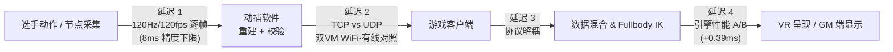

# 04 · 软硬件全链路控变量评测与研发流程治理

> **一句话价值**：在切入 AI 工程与评测之前，已通过 **6 年一线游戏与 XR 复杂系统（育碧 / 腾讯内包 / 中手游外包 Leader / 英雄体育 QA Lead）** 锤炼出与 AI Eval 底层完全同源的方法论——**多段延迟拆解、控变量实验设计、多架构量化横评、研发分支治理与内部工具产品化**。本模块所有实验设计、数据采集、流程文档与 PRD 均为本人独立主导落地。

---

## 一、VR 动捕全链路延迟拆解与硬件选型拍板（STAR）

### S · Situation（背景与痛点）
在虚拟跆拳道全球竞技赛事项目（VTKD，2024 年新加坡首届国际锦标赛覆盖 23 个国家/地区、120+ 选手）中，端到端体感延迟与磁干扰漂移直接决定竞技公平性与选手眩晕感。市面上光学、惯性穿戴、视觉三大动捕路线参数各异，厂商宣传口径无法直接指导赛事选型。

### T · Task（核心目标）
搭建一套排除人工操作与器材误差干扰的**控变量全链路评测体系**，拆清从选手动作到 VR/裁判端呈现的每一段延迟，并为项目硬件选型提供可量化的决策依据。

### A · Action（本人主导的关键动作）
1. **4 段端到端延迟拆解与去干扰实验装置**：梳理出「动作采集 → 动捕软件重建 → 游戏客户端通信与解耦 → 骨骼融合与端侧呈现」4 段独立测量链路；评估机位误差后敲定**单机双虚拟机（WiFi vs. 有线同步对照）**，配合可调速电动转盘、计数器及真人双激光对射传感器精确标定起止点。
2. **协议级底层排障与性能拆解**：实测定位第三方动捕 SDK 原始 UDP 通信失败根因并打通采集；通过引擎性能分析器 A/B 对比全身反向动力学（Fullbody IK）帧开销（差值 `+0.39ms`），拆分各段延迟预算。
3. **3 架构 × 6 设备 × 7 维度量化横评**：在统一口径下执行延迟测试与 5 分钟 / 10 组强磁场累积偏移压测，综合精准性、延迟率、稳定性与穿戴节点数做选型推演。

### R · Result（可验证结果）
- 输出 **23 页全链路延迟测试方案**与 **16 页多架构硬件横评总结**（见下方公开原件）；
- 最终推动项目拍板采用**核心 5 节点（双臂、双腿、胸）穿戴式动捕方案**，稳定支撑国际赛事落地。

| 动捕架构 | 评测设备 | 实测平均延迟 | 5 分钟/10 组强磁场累积偏移压测 | 分场景选型结论 |
| :--- | :--- | :---: | :--- | :--- |
| **光学动捕** | VICON | **`43.8ms`**（33–66ms） | 光学不受磁干扰 | 正式国际大赛性能最优（配合低成本方案评估） |
| **惯性穿戴** | AXIS | **`53.5ms`**（50–67ms） | 第 1 组即明显偏移，后续未继续恶化 | 适合日常训练或配合赛事校准流程管理 |
| **惯性穿戴** | 诺亦腾（关脚锁） | **`112.8ms`**（100–133ms） | 前期可接受，`3'30"` 后劣化至不可接受 | 佩戴佳但延迟 >100ms 且强磁易掉线 |
| **惯性穿戴** | 虚拟动力（关脚锁） | **`198.1ms`**（166–250ms） | 抗磁最佳，`4'30"` 仅轻微偏移 | 延迟过高淘汰 |
| **视觉动捕** | 迪迈 / CY | **`>100ms` / `>200ms`** | 视觉不受磁干扰 | 迪迈为低成本 toC 备选；CY 识别失效淘汰 |

---

## 二、研发分支治理、656 用例架构与内部提效工具 PRD（STAR）

### S / T · 背景与目标
旧流程中 QA 在不稳定的开发分支提前验收，导致需求单过早关闭、主干合入后返工无法追踪；同时多人多端联调冒烟成本高、效率低。

### A · 本人主导的关键动作
1. **重构 9 周分支与发布治理流**：明确开发分支由策划冒烟、周迭代合入、第 6 周封版，QA 统一在主干/发布分支验收与回归，从流程源头根治返工黑洞。
2. **搭建 656 条四域用例体系 + 引擎直测方案**：覆盖功能（GM / 观战 / 端侧 / 战斗 / 对局）、硬件、网络拓扑与极限断服异常；推动引擎直测同时模拟裁判端与选手端。
3. **输出 2 份内部测试工具 PRD**：独立规划四端一键启动与悬浮多视口监控、私服公用化、键盘出招与动作录制裁剪、对战假人、GM 调试面板及头显休眠/边界状态模拟。

### R · 可验证结果
- 冒烟测试耗时由 **3 人 20–30 分钟压缩至单人 5–10 分钟**；
- 形成完整的流程治理、用例体系与工具产品化沉淀。

---

## 三、原始文档与排障细节索引

| 索引入口 | 内容摘要 |
| :--- | :--- |
| **[跨领域 5 大真实工程根因排障案例复盘](./engineering-postmortems.md)** | 含第三方动捕 SDK UDP 初始化故障、隐藏楼层偏移等底层排障实录 |
| **[飞书公开作品集《测试文档》（免登录直阅）](https://jcn3qpi51ul0.feishu.cn/drive/folder/Lj6cfpcyzluJ6Bd5zq1cfjw0nTd)** | 23 页全链路延迟方案、16 页硬件横评总结、9 周研发流程梳理、2 份工具 PRD 与游戏系统策划文档原件 |
