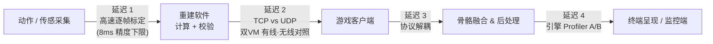

# 04 · 软硬件全链路控变量评测与研发流程治理（通用方法论抽象）

> [!NOTE]
> **合规与净室声明（Clean-Room Disclaimer）**：本目录所载评测框架、分支治理模型与排障复盘均为作者基于行业通用场景独立抽象的工程方法论（Clean-room abstraction），不包含任何过往及现任职企业的内部机密数据、商业硬件实测原表、私有代码或受 NDA 保护资产。

> **一句话价值**：与 AI Eval 底层完全同源的工程方法论——**多段延迟拆解、控变量实验设计、多路线量化选型框架、研发分支治理与内部工具产品化思路**。

---

## 零、15 秒总览：三大系统评测与治理通用 Before / After 对照（Clean-Room）

| 治理维度 | ❌ BEFORE（行业典型黑盒顽疾） | ✅ AFTER（控变量拆解与流程/工具治理） |
| :--- | :--- | :--- |
| **1. “体感慢”跨组甩锅** | 引擎组、采集软件组与网络组凭主观体感互相甩锅，说不清瓶颈在传感器、重建软件、传输协议还是引擎骨骼后处理 | 拆分为 **4 段独立可测区间** + 同机双虚拟机有线/无线隔离 + 8 ms 高速逐帧/激光标定 + 引擎 Profiler A/B 开关对照；数据直接证伪无关环节、锁定真正传输段瓶颈并定位 UDP 跳过握手导致魔数 ID 映射失效的协议根因 |
| **2. 多分支研发返工黑洞** | 功能在开发分支不稳定时即提前验证关单，合入主干后冲突与回退频发、缺陷流转断链，临近上线陷入失控返工 | 确立「开发分支策划冒烟 → 周迭代合入 → 封版 → QA 统一主干/发布分支验收」固定节奏，配合四域用例架构封堵返工黑洞 |
| **3. 多端联动手工冒烟** | 每次回归需多人、多台设备同步联调才能跑完一轮基础冒烟，耗人耗时且边界异常极难复现 | 通过引擎内直测单机模拟多端角色，将多人长耗时手工冒烟压缩为**单人分钟级自检**，并沉淀多端一键启动、动作录制裁剪与对战假人等提效工具 PRD 范式 |

---

## 一、实时交互系统全链路延迟拆解与多路线选型方法论

### S · 行业共性痛点
在实时交互与传感同步系统中，“体感慢”常引发客户端引擎、网络传输与采集软件各组互相甩锅，且不同硬件路线（光学 / 惯性穿戴 / 视觉）的厂商宣传口径无法直接指导工程选型。

### A · 控变量拆解框架
1. **4 段端到端延迟拆解与去干扰装置**：将黑盒链路拆为「动作采集 → 重建软件 → 客户端通信与解耦 → 引擎骨骼融合与呈现」4 段可独立测量区间；采用同机双虚拟机隔离有线/无线变量，配合高速逐帧（8 ms 精度）与激光触发器精确标定起止点。
2. **协议排查与引擎 A/B 证伪**：抓包比对 TCP/UDP 握手路径定位协议映射缺陷；利用引擎 Profiler 做 A/B 开关对照，量化后处理骨骼融合的真实帧开销，用数据终结跨组甩锅。
3. **3 路线 × 多维度选型矩阵**：在统一口径下叠加延迟基线与强磁场连续漂移压测，按正式竞技、日常训练与低成本普及三类业务场景分别给出选型边界，不以单一最高参数一刀切。

| 技术路线（匿名抽象） | 典型延迟区间特征 | 强磁场抗干扰特性 | 典型适用场景 |
| :--- | :--- | :--- | :--- |
| **光学方案（路线 A）** | 极低延迟 | 不受磁场干扰 | 高规格固定场地正式竞技 |
| **惯性穿戴（路线 B–D）** | 中低至高延迟分化明显 | 需重点做持续强磁累积漂移压测 | 便携部署、日常训练与分级穿戴方案 |
| **视觉方案（路线 E–F）** | 偏高延迟，易受遮挡影响 | 不受磁场干扰 | 低成本普及端备选，高对抗场景慎用 |

---

## 二、研发分支治理与内部提效工具抽象模型

### S / T · 共性痛点与目标
开发分支不稳定时提前结单会导致主干合入后返工无追踪；多端联调冒烟依赖多人手工配合，耗时且难复现。

### A · 治理与工具化思路
1. **固定周期分支治理流**：开发分支由策划冒烟、周迭代合入、封版后由 QA 统一在主干/发布分支验收回归，从流程源头封堵“分支已关单、主干仍返工”黑洞。
2. **四域用例架构 + 引擎直测降本**：按功能、硬件、网络拓扑、极限断服四域组织用例；通过引擎内直测单机模拟多端角色，将多人协作冒烟压减为单人快速自检。
3. **内部工具产品化 PRD 思路**：聚焦高频痛点抽象工具需求（多端一键启动与多视口监控、动作录制裁剪、对战假人、调试面板与硬件边界模拟）。

---

## 三、通用排障方法论索引

| 索引入口 | 内容摘要 |
| :--- | :--- |
| **[跨领域 5 大通用工程根因排障案例复盘](./engineering-postmortems.md)** | 含协议握手初始化故障、Windows 原子写 Flaky Test、跨平台换行符哈希误报、流水线节点追踪与前端 DOM 隔离等通用排障实录 |
