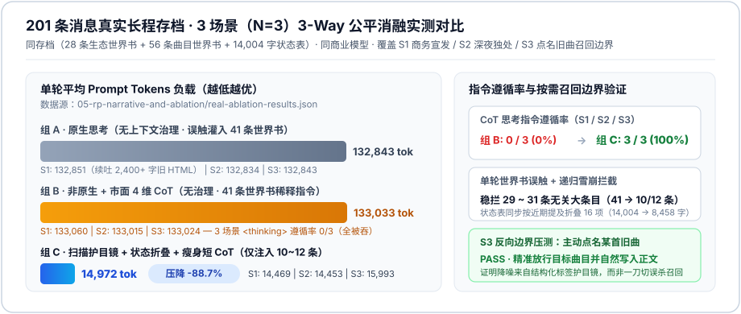
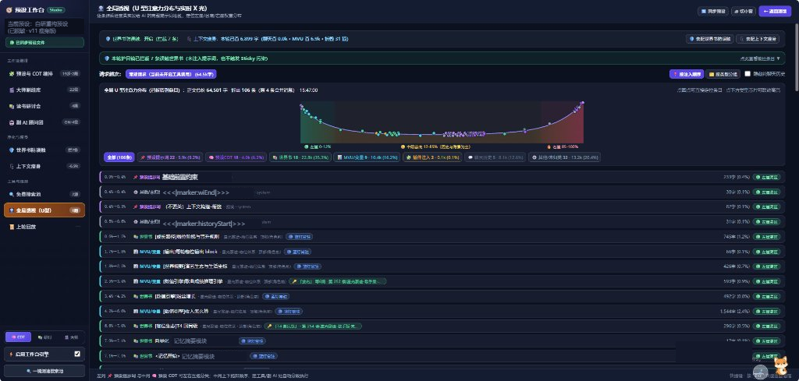

# 05 · 长对话上下文误触降噪与 CoT 瘦身实测

> 本目录保留长程对话系统的两项纯工程排查实证数据：**① 标签前置过滤修复知识库误触发（`N=3` 场景对照）**；**② 思维链模板冗余瘦身（`9,708 字 → 320 字`）**。

---

## 1. 长程对话（201 轮）知识库误触降噪对照（`N=3` 场景）

**问题根因**：在一段累积 201 轮的长对话存档中，旧版关键词扫描未过滤历史消息里的 `<thinking>` 思考块与结构化状态 HTML 标签，导致每轮错误触发 **31 条无关知识库条目**（单轮 Prompt 异常膨胀至 `~133k` Token），不仅烧成本，还导致商业模型在中段注意力稀释下完全忽略输出思考标签的指令（`0/3` 遵循）。

**修复与实测验证**（原始脱敏数据见 [`real-ablation-results.json`](./real-ablation-results.json)）：
- 在扫描前剥离思考块与状态标签，并折叠未提及的静态状态子项（状态表 `14,004 → 8,458` 字）；
- 覆盖 3 类场景（常规业务 / 纯情绪 / **S3 点名旧条目召回边界验证不误杀**）做同模型三组对照：

| 场景 | 组 A · 无治理基线 | 组 B · 市面常规 4 维 CoT | 组 C · 前置标签过滤 + 极简短 CoT |
| :--- | :--- | :--- | :--- |
| **S1 常规业务** | `41` 条 · `132,851` tok | `133,060` tok · 思考遵循失败 | `10` 条 · `14,469` tok · 遵循成功 (`52` 字) |
| **S2 纯情绪无业务词** | `41` 条 · `132,834` tok | `133,015` tok · 思考遵循失败 | `10` 条 · `14,453` tok · 遵循成功 (`62` 字) |
| **S3 点名旧条目召回** | `41` 条 · `132,843` tok | `133,024` tok · 思考遵循失败 | `12` 条 · `15,993` tok · 精准召回不误杀 |

- **实验边界**：本对照基于单份 201 轮长对话存档的 3 类场景（`N=3`），验证前置标签过滤对知识库误触膨胀（`133k → 15k`，`-88.7%`）及格式指令遵循的修复效果，并在 S3 确认显式点名旧条目的正常召回。

---

## 2. 思维链（CoT）规则复读瘦身实测（`9,708 字 → 320 字`，`-96.7%`）

旧版提示词强行要求“逐条复述规则再分析”，导致模型单轮隐藏思考高达 `9,708` 字（90% 在机械复述提示词条目），严重拉长首字等待并挤占输出预算。删掉强制复述条款、改为只输出当轮状态因果收束后，单轮 CoT 稳定压至 `~320` 字。

---

## 3. 实机上下文诊断界面

| 全局注意力区间分布与状态折叠统计 | 关键词扫描前置过滤拦截明细 |
| :---: | :---: |
|  |  |
