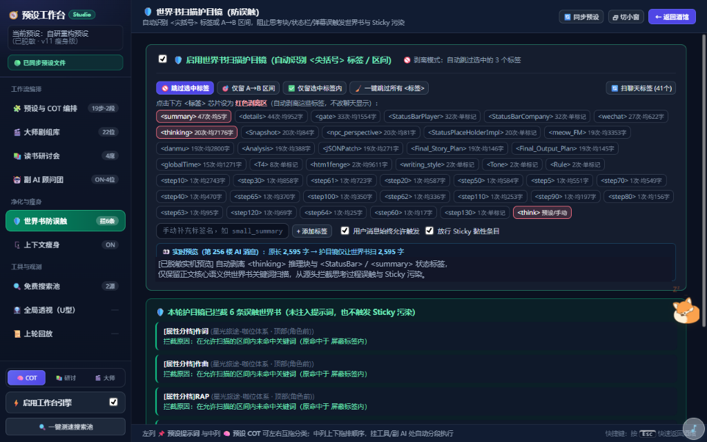

# 05 · 长程 AI 互动叙事 Spec、真实存档原文比对 & 201 楼消融

> [!NOTE]
> **Spec 驱动展示与知识产权边界**：本模块核心展示作者的 **问题定义、根因拆解、Spec 架构设计与真实存档 Before/After 原文效果印证**。为保护个人核心创作资产，仓库不公开可直接复制粘贴的成品提示词/世界书/裁定脚本源码（仅展示抽象 Spec 蓝图与真实运行输出的原文对照）；面试阶段可白板深挖或在受控环境实机演示。

---

## 一、15 秒首屏实证：真实长程存档「废弃重 Roll / 旧版 vs 定稿 / 新版」原文比对

以下全部为本人真实长程运行存档中的**实际输出原文摘录**（零合成脚本充数；仅隐去少量无关系统元标签，保留真实对话与思考原貌）：

---

### 比对 1 · 同上下文重 Roll：无脑送钱爽文（被打回） vs 真实制度阻力（定稿引爆高潮）
> 来源：演艺长程模拟真实存档 `T121`（被玩家当场打回：`重roll，剧情太无聊了`） vs `T123`（重 Roll 定稿）

#### ❌ BEFORE · 废弃楼层原文（`T121` · 无阻力送钱 + 机械降神）
> 电话那头的第三个人，是苹果公司负责 iTunes 全球业务的副总裁 Eddy Cue。此时距离 6 月 29 日初代 iPhone 在全美正式上市只剩最后七天。库比蒂诺总部在三天前刚刚推翻了原本定好的第三支电视广告配乐，乔布斯与营销团队在听完当周刚冲上全美专辑榜第一的《UNANSWERED》后，当场拍板要用《As Usual》开头那段极具辨识度的皮鞋踏木板声与零混响干声……  
> 「We need thirty seconds of 'As Usual' for the global launch spot airing next Friday, MOON. Eight hundred thousand dollars flat for a one-year broadcast sync...」  
> （随后经纪人补充：环球与索尼总部 A&R 副总裁为了抢下一张专辑发行权，一天往邮箱里塞十封报价信。）

- **玩家当场打回原话（`T122`）**：`重roll，剧情太无聊了`

#### ✅ AFTER · 正式定稿原文（`T123` · 引入真实行业规则阻力）
> 桌角的跨洋座机突然响了起来，李成洙瞥了一眼来电显示上的纽约区号，伸手按下免提键。工作站的显示屏同时亮起弹窗，一封来自 Matador 总裁 Chris Lombardi 的加急邮件直接展开在桌面中央：
> ```text
> SUBJECT: [URGENT] Fwd: NARAS 50th Grammy Screening Committee — Category Flag #07-419
> Entry Title: UNANSWERED — MOON | Submitted Field: Album Of The Year (AOTY)
> Status: ELIGIBILITY CHALLENGED
> Committee Note: Per NARAS Rulebook Sec. IV-B, entries containing 5 tracks with a total
> running time of 21m 48s fall below the 30-minute standard LP threshold. 14 voting members
> of the Santa Monica panel have petitioned to reclassify the release as an EP...
> ```

- **效果印证**：砍掉“全员排队送钱”的廉价爽文后，真实制度阻力瞬间点燃策略心流——直接催生玩家后续 10 余轮反向撤回全部 9 项申报、架 DV 录 `30m01s` 静音讽刺视频撬动舆论、在对方妥协给特别豁免时干脆拒奖的连续涌现名场面。

---

### 比对 2 · 完全同楼层弃稿 vs 定稿：复读工具人跟班 vs 跨洋空间对位 + 镜头离场收尾
> 来源：同一存档完全相同的用户输入 `T134`（玩家决定彻底拒绝格莱美特别豁免、隔空点名回话）

#### ❌ BEFORE · 弃稿分支原文（`T135` · 漏读通话语境 + 浮夸碎纸机跟班腔）
> 李成洙站在调音台旁边……手里捏着那份刚从圣莫尼卡传真过来的录音学院理事会特别豁免函。  
> 你把怀里的古典吉他轻轻放回琴架上……「成洙哥，声明是我发出去的，如果他们特别豁免了然后我再回去，难道他们就不会在投票上恶心我么？」  
> ……（结尾）李成洙把豁免传真丢进桌角碎纸机槽口：*“哈哈……没错，星号！……我马上联系克里斯·隆巴迪加开压片产线。格莱美免费给我们搭了这么大一个台子，这要是不吃到双白金，那才叫傻子。”*  
> 碎纸机发出低沉的齿轮咬合声，将那纸印着金留声机的豁免函切成了细碎的纸条。

#### ✅ AFTER · 定稿分支原文（`T135` · 跨洋空间对位 + 克制留白镜头离场）
> 首尔清潭洞的午前阳光穿过百叶窗，落在工作室的调音台推子上。  
> 桌面中央的八爪鱼免提电话亮着绿灯，扬声器里透出加州马里布傍晚微弱的海浪底噪。  
> 你怀里虚拢着那把古典吉他，指腹轻轻按住还在微颤的尼龙弦，止住了尾音。  
> 「The statement was issued by me. If they grant a special waiver and I go back now, won't they just screw me over in the voting anyway?」  
> ……（结尾定格在主控台显示器的公开回复草稿界面）
> ```text
> THANKS, BUT NO THANKS.
> — Lin Muhe (MOON) | Cheongdam-dong, Seoul | 100% Master & Publishing Owner
> READY TO SEND (scheduled: +60 mins)
> ```
> 光标在句末的句号后一明一暗地闪烁，定时发送的倒计时停在六十分钟整。

- **效果印证**：同一句用户输入下，弃稿把越洋电话写成了“跟身边人复述台词 + 碎纸机喊口号”；定稿精准对齐两地时差与语种，用一闪一灭的光标与 60 分钟倒计时完成极高张力的无问号镜头离场。

---

### 比对 3 · 同作品跨代演进：`9,708 字`复读机 CoT vs `320 字`因果收束 + 镜头离场（实测压减 `-96.7%`）
> 来源：动作/超自然长程模拟 · 旧版预设 `T1189`（`2026-05`） vs 重构瘦身预设 `T402`（`2026-11`）

#### ❌ BEFORE · 旧版 CoT 原文节选（单轮思考高达 **`9,708 字`**，90% 在逐条背诵规则）
> ```text
> 零、核心基调确认
> - 禁止COT缩水，严禁压缩任何条目/字数/流程。以复述要求+分析的格式一条条分析COT，禁止擅自整合
>   分析：明白，我会在思考过程中详细展开每一个要求，绝不跳步，保证字数和逻辑的完整性。
> - 禁止复杂的主从嵌套，只用动宾结构、干脆利落的句式
>   分析：正文的句子要短，少用修饰语，多用动词和名词直接推进动作和画面。
> - 永远规避毫无情感波动/冰冷生硬没有感情的npc人设，必须要有人情味
>   分析：角色A的人设本来就是温和、有礼貌但在战斗中又有一种偏执果决感的……
> ```

#### ✅ AFTER · 新版实机 CoT 全文（仅 **`320 字`**，零规则复读，人名已脱敏）+ 实机结尾原文
> **完整 CoT 原文（320 字）**：
> ```text
> 本轮是晚20:18的学院医务室日常收尾戏。主角刚分完四件特级装备，顺口提了一句两名新成员已安全安置、正式成为预备生。
> 按人物各自性格底色写自然反应：角色B把装有暗账和同意书的黑漆金库盒收好，趁夜送给导师甲盖章立案，赶在周一排查前把手续坐实；角色C啃甜点乐呵看吃瘪笑话；校医角色D保持冷吐槽本色催补水并收拾桌面；两名新成员听到要来更小的孩子也有可爱反应。
> 行文保持轻盈短段与自然对白，结尾落在角色B拎着金库盒推门去找导师甲的动作上，不向主角发问，最后补齐状态摘要与变量更新。
> ```
> **对应正文结尾原文（对比旧版“问号甩锅”：`间隔留多少天合适？`）**：
> > 角色B无奈地笑了笑，单手拎着黑漆金库盒，另一只手把折叠好的三节长棍搭在肩头。  
> > 他推开医务室的木门，夏夜微凉的晚风顺着门缝卷了进来，吹动了窗台上挂着的白色薄纱帘。  
> > 走廊外，角色B平稳的脚步声渐渐远去，医务室里只剩下空调轻微的送风声，以及两名新成员正小声讨论怎么当“前辈”的嘀咕声。

---

### 比对 4 · 外置 `<combat_oracle>` 硬骰受挫 → 逼出情报侦察与玩家自创赌命策略
> 来源：同一动作长程存档 `T183–186` & `T220`（对比早期无外置裁定时一刀平推强敌的爽文惯性，专有名词已脱敏）

- **`T184` 硬骰受挫实录**：玩家连放招牌剑技突袭特级主核体，外置真骰掷出 **`2d10 = 2+2`（修正 `-10`），进攻差值 `-32` → 触发硬阈值 `【碾压劣势】`**，CoT 严格服从红线（*“正面硬拼必遭重创或溃败，严禁强行爆种秒杀，只能靠队友掩护、削偏保命或撤退拉距”*），主核体当场过载喷发腐血荆棘封死落脚点，逼玩家滑步保命。
- **`T185–186` 倒逼情报博弈与代价兑现**：硬打不动后玩家改用刀尖点水做 `42.8 kHz` 水下声波三维测绘，揪出被压住的只是 84% 空腔伪装肉壳、真核已沿河床下 3.2 米暗渠逃逸；同时在 `ASV 111 vs CT 142（-31 明显下风）` 裁定下，超频冷却眩晕撞上水下暗雷引爆，两吨礁石炸碎、玩家滞空挂彩。
- **`T220` 逼出玩家现场自创高光策略**：正因为嘴炮无效，面对四具高阶目标突袭时玩家现场定下赌命等价契约**「叩」**（*“只要不是极限暴击就不造成伤害，所有伤害累积到下一次极限暴击作为 2.5 次方基数一起爆发”*），配合真骰连击窗口写出：
  > *十四记足以将花岗岩刺成蜂窝的极速重刺结结实实扎在异骸核心上，却连对方表皮的黑蜡符纸都没能刺破分毫。丁号赤骸胸口完好无损，反倒是你右臂的肌腱因连续十四次零伤害的动能滞留而绷紧到了极点。*

---

### 人类真实试错伤疤（每一条 Spec 背后都是被 AI 折磨出来的真实 OOC 记录）
- **问号甩锅伤疤**：旧版在 `T67` 结尾抛出*“《Room Tone》上线日期和她们的回归预告之间，间隔留多少天合适？”*，玩家在 `T68` 当场打断 *`//结尾不要老是留问题，规则里已经写了，不准以疑问句结尾`* → 直接催生 **阶段完成感 + 镜头离场收尾 Spec**。
- **假活人感伤疤**：深夜发一条冷幽默动态后，旧版让所有熟人排队发消息刷屏，玩家在 `T201` 批注 *`//禁止乱七八糟的消息全塞过来，活人感不是你这么加的`* → 确立 **克制留白与独立生活底线 Spec**。
- **防嘴炮矫枉过正伤疤**：玩家在 `T220` 提出高风险等价束缚时专门加注 *`//仅判断是否对等，严禁在等价交换的情况下还非要再附加代价`* → 推动 **删除非对称惩罚补丁、回归中性客观裁定**。
- **旧变量串时伤疤**：玩家在 `T118` 揪出模型把已发行 5 周的专辑当刚发售播报 → 推动 **历史标签剥离与状态表按提及折叠机制**。

---

## 二、核心设计 Spec 蓝图索引（重解题思路，防源码照抄）

| 设计模块 | Spec 蓝图入口 | 核心解决什么问题 |
| :--- | :--- | :--- |
| **叙事预设与 CoT 因果链 Spec** | [narrative-preset-core-modules.md](./narrative-preset-core-modules.md) | 预设 `270→70 条 / 55,890→12,170 字` 瘦身思路、四项品味可执行判据、NPC 视角隔离槽位与双凭证锁稿契约 |
| **动态世界模拟与硬裁定 Spec** | [world-simulation-rules.md](./world-simulation-rules.md) | “规则算、模型演”解耦架构、三支柱防通胀门禁、五档战力/四档赛场硬阈值、多水流视野与 `A—C—B` 社交图约束 |

---

## 三、201 条消息真实长程原卡 `N=3` 多场景 3-Way 公平消融实测

用同一张跑了 **201 条消息的原创长程存档**（内置 28 条生态世界书 + 56 条曲目世界书 + 14,004 字真实状态表 + 11 条可见楼层）、同一商业模型，覆盖 **3 类不同场景**（含反向召回边界压测）做零丑化 3-Way 公平消融（脱敏实测数据见 [`real-ablation-results.json`](./real-ablation-results.json)）：

| 测试场景 | 组 A · 原生思考（无治理） | 组 B · 非原生 + 市面优质 4 维 CoT | 组 C · 上下文净化 + 瘦身 + 极简短 CoT | 关键验证点 |
| :--- | :--- | :--- | :--- | :--- |
| **S1 · 商务宣发会议**<br>（不提旧曲） | `41` 条｜`132,851` / `135,139` tok<br>（续吐 2,400+ 字旧 HTML） | `41` 条｜`133,060` / `134,750` tok<br>**`<thinking>` 遵循：失败（0 字）** | **`10` 条｜`14,469` / `15,643` tok**<br>**`<cot>` 遵循：成功（52 字）** | 拦 31 条误触/递归；Prompt 压回 `~1.45 万`；时间线与状态补丁零丢失 |
| **S2 · 深夜情绪独处**<br>（纯情绪零业务词） | `41` 条｜`132,834` / `133,622` tok | `41` 条｜`133,015` / `134,069` tok<br>**`<thinking>` 遵循：失败（0 字）** | **`10` 条｜`14,453` / `15,341` tok**<br>**`<cot>` 遵循：成功（62 字）** | 纯情绪场景同样稳拦 31 条误触，133k 组再次吞掉 CoT 指令 |
| **S3 · 点名旧曲召回边界**<br>（验证不误杀） | `41` 条｜`132,843` / `133,759` tok | `41` 条｜`133,024` / `134,624` tok<br>**`<thinking>` 遵循：失败（0 字）** | **`12` 条｜`15,993` / `17,139` tok**<br>**`<cot>` 遵循：成功（78 字）** | **精准放行点名旧曲并写入正文**，同时继续拦掉其余 29 条无关误触 |
| **3 场景实测汇总** | 均值 `132,843` Prompt tok | 均值 `133,033` Prompt tok<br>CoT 遵循：3 场景全失守 | **均值 `14,972` Prompt tok**<br>**CoT 遵循：3 场景全按规执行** | **既证降本与抗注意力稀释，又证按需精准召回不误杀** |

- **拦截的 31 条真实垃圾触发明细**：17 条未提及的 2k–8k 字大曲目条目（因历史状态标签被裸扫误触）+ 7 条递归第 1 层雪崩条目 + 7 条未提及分档条目；同时状态表按近期提及自动折叠 16 个未出场子项（`14,004 → 8,458` 字）。
- **诚实边界声明（不报喜不报忧）**：
  1. 本消融为 `N=3` 重度真实存档对照，重在验证机制因果与召回边界（S3 证实点名旧曲精准放行不误杀），不拿小样本虚吹通用全量指标；
  2. 第三方中转节点并发存在排队抖动且未透传 `reasoning_effort`，因此不拿单次中转耗时宣称“提速”，只认实测 Token、误触数、召回精度与指令遵循率；
  3. 极简短 CoT 需与体验收尾约束（如结尾无问号）配合使用，S2/S3 加上陈述句收尾约束后结尾表现更稳。

---

## 四、从长程实验态到商业实时游戏的量产裁剪架构（System 1 快脑 × System 2 慢脑）

> **边界说明**：上文 `~1.5 万 Token/轮` 为个人重度长文本沙盒（单档数千轮长篇叙事）的实测稳态；当面向**商业 3D/2D 图形游戏智能 NPC 或十万级 DAU 泛娱乐产品**落地时，必须按算力毛利与秒级延迟刚需做分层裁剪：

| 架构层级 | 重度长叙事实验态（探明失效边界） | 商业游戏 / 高并发 C 端实时量产态（控毛利保延迟） |
| :--- | :--- | :--- |
| **第 0 层 · 规则裁定** | 外置 JS 宏结算 5 档实力差 / 4 档赛场真骰与生态水位 | **100% 本地确定性代码先行裁定（`0 ms / 0 Token`）**：底价硬锁、实力差阈值与冷却锁死在引擎侧，物理杜绝嘴炮白嫖与秒杀 |
| **前台交互（System 1）** | `~1.5 万 Token` 完整叙事上下文 + 短 CoT + 长段落演出 | **轻量快模型 `< 1,800–2,500 Token`（目标 `TTFT < 0.8–1.2s`）**：仅注入静态人设前缀（高命中 Prefix Cache）+ 局部增量 + 硬裁定结果，受控输出 `{emotion, action, target, short_bark}` 驱动动画状态机与短语音气泡 |
| **后台演化（System 2）** | 随轮或定频更新长线暗流、蝴蝶锚点与偏好黑白名单 | **每 `5–8` 轮后台异步静默队列（零阻塞前台）**：第四面墙真实输入偏好提取、两级记忆去重压缩、非在场 NPC 日程演化与群体教练统筹全部异步化 |
| **异常降级兜底** | 三级标签容错解析免重跑 | **超时（`> 1.5s`）或 JSON 解析异常 0 延迟无损回退传统配置表保底台词 + 标准 UI**，绝不卡死玩家核心主流程 |

---

## 五、实机运行界面佐证（已脱敏）

1. **世界书扫描护目镜（防误触核心机制实拍）**：自动识别 41 个结构标签并屏蔽 `<thinking>` / 状态栏干扰区；下方绿色明细为真实长程存档第 256 楼实机拦下的误触条目（未注入提示词，也不触发 Sticky 污染）。



2. **全局 U 型注意力 X 光透视与实时瘦身统计**：可视化 106 条已装配提示词在左崖 / 谷底 / 右崖的真实权重落点，并实时展示护目镜拦截条数与状态折叠节省字数（本轮折叠 31 项、省 6,899 字）。


3. **真实大师剧组库（编剧 / 导演 / 作家范文卡与动态点将）**：按场景类型匹配对应创作者技法档案与范文卡，避免空泛的“写得更有文采”口号式指令。


