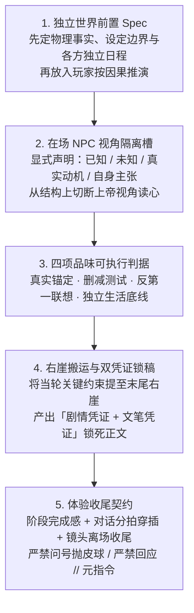

# 叙事预设重构与 CoT 因果决策链 · Spec 设计蓝图

> [!NOTE]
> **知识产权与展示边界（Spec-First Disclosure）**：本文档重点展示作者的 **Spec 驱动问题拆解思路、核心失败根因诊断、架构契约与验收判据**；为保护个人核心创作资产（及尊重社区载体边界），**不公开可直接复制粘贴的成品提示词全文原件**。面试阶段可现场白板拆解或在受控环境下实机演示运行效果。

---

## 一、核心工程背景：为什么从 `270 条 / 55,890 字` 归零重构至 `70 条 / 12,170 字`？

旧版长程叙事预设的崩溃不是“写得不够细”，而是**补丁叠补丁制造了系统性自相矛盾**：
- **失效根因 1（粉红大象效应 + 非对称偏置）**：为防止 NPC 顺从玩家，在总则、锚点、思维链里反复堆砌 26 处“严禁顺从/讨好”禁令 → 模型注意力被反向锁死在“对抗”上，把 NPC 逼成无理抬杠的杠精。
- **失效根因 2（复印机式 CoT）**：旧规则强求“禁止 CoT 缩水、逐条复述分析” → 实测单轮 CoT 膨胀至 **9,708 字**，90% 在复读规则表态（*“明白，我会严格执行”*），既烧钱又无法防止正文“想一套、写一套”。
- **失效根因 3（主观品味停留在口号层）**：只写“要有真实感、活人感、别写流水账”，模型根本没有可执行的二元判定标准。

---

## 二、Spec 架构设计：五层正向运行机制（替代黑名单补丁）



### 1. 独立世界前置 Spec（根治主角中心化与杠精极化）
- **设计思路**：不靠写死“不许讨好”或“不许抬杠”双边打补丁，而是修正底层生成顺序——**先独立计算没有主角时的世界状态、资源约束与各方既定日程，再将玩家言行作为新变量输入因果链**。
- **验收效果**：总则由 `3,864 字` 瘦身至 `1,732 字`，禁令词由 `26 → 1`，既消除了无脑舔主角，也清除了过纠抬杠。

### 2. 把主观品味转译为 4 项“可证伪、可执行”的硬判据
| 品味痛点 | 传统失效写法（口号） | 本人设计的 Spec 可执行判据（解题思路） |
| :--- | :--- | :--- |
| **真实感** | “写得真实一点、别像网文” | **双锚定测试**：① 任何领域/机构/作品强制锚定具体实名对象防模板化；② 成败必溯源到具体能力、资源与选择，只限制“无能力却无条件成功” |
| **祛流水账** | “不要水字数、紧凑一点” | **删减测试（Subtraction Test）**：若把一段环境或动作描写删掉后，人物关系、已知信息或局势后果**零实质变化**，则判定为琐碎必须跳过；信息只在冲突/行动中显现，对白单句只扛一个信息点 |
| **求新意** | “剧情要有新意、别重复” | **反第一联想 + 反同源衍生**：显式记录脑中第一个套路并写明反对理由；明确“同一元素的不同阶段/衍生品仍算旧元素”，强制用双锚点交集（`A ∩ B → C`）引出新人物与新冲突 |
| **活人感** | “让 NPC 像真人一样” | **删掉主角测试**：假设把主角从场景抹去，NPC 是否仍有自身生活、说话习惯与无所图的私人善意（区分熟人私域善意 vs 陌生人利益对等，避免全员功利机器） |

### 3. CoT 因果决策链与视角隔离槽位（Schema 骨架示例）
为彻底消灭“复读机 CoT”与“跨场景读心剧透”，定义极简结构化槽位（**只填当轮有效决策，严禁复述规则**）：

```yaml
# 抽象 Spec 骨架（非成品提示词）
turn_decision_chain:
  world_first_facts:       "本轮既定客观事实与物理/规则边界（先于玩家动作）"
  npc_perspective_slots:   # 逐位在场角色隔离
    - actor: "NPC_ID"
      knows:      "仅限剧情内亲历/观察/听闻的信息"
      does_not_know: "他人秘密与场外计划（未获线索前严禁知晓）"
      inner_stance:  "10-30字真实内心立场"
      independent_action: "基于自身日程与性格的下一步行动"
  anti_cliche_check:       "首条第一联想（显式否决） -> 新破局切口"
  dual_credentials_lock:   # 双凭证锁死正文，防“想一套写一套”
    story_plan_ref:   "最终剧情落点与分拍穿插顺序"
    style_plan_ref:   "当轮主辅文风技法与镜头离场收尾动作"
```

### 4. 交互体验与边界硬契约
- **元指令静默执行**：玩家以 `//` 触发的纠偏指令只作用于后台规划，严禁在正文或角色台词中复述、吐槽或打破第四面墙。
- **对话分拍穿插**：当玩家单次输入包含多指向动作/台词时，拆拍穿插角色即时反应，杜绝“玩家一口气说完十句、NPC 末尾统一写总结”。
- **阶段完成感 + 镜头离场收尾**：每轮推进完当前小节拍即以自然环境/动作拉远定格，彻底封堵“你接下来打算怎么做？”式问号甩锅。

---

## 三、代表性规则切片原件与设计解析（Sample Slices · 展示 2 条，其余 68 条锁死不公开）

为验证 Spec 写作功力并非纸上谈兵，以下公开 2 条 100% 本人原创、极具代表性的独立判据切片及背后设计逻辑：

### 切片 1 ·「祛流水账删减测试（Subtraction Test）」
```text
写一段流程之前，先找出其中真正有情绪或戏剧性的节点，以这些节点为中心组织叙事；其余事务性环节用结果带过。
需要给信息时，让信息在行动、冲突或后果里自己出现，而不是像简报一样灌输。
吃喝、闲聊、独处只有在推动了关系、情绪或情节时才值得展开；删掉后什么都不会损失的内容直接跳过。
如果一段只能靠环境和动作维持，删掉动作后没有实质变化，就说明它是琐碎的——把笔墨留给即使去掉环境和动作，仍然留下了关系、信息或后果变化的段落。
```
- **为什么这么设计？** 传统 Prompt 爱写“不要写流水账、节奏紧凑点”，但大模型对“紧凑”毫无客观抓手，反而会把正常情绪戏砍干。这里把它改写成一个**可执行的二元删减测试**：让模型自检“删掉环境与动作后，是否留下关系/信息/后果三者之一的增量变化？”——有则写，无则跳，直接把主观审美变成了可判定规则。

### 切片 2 ·「反第一联想与反同源衍生」
```text
面对情境时，把第一个跳出来的联想记下来，然后明确反对它，再提出一个不同的方案。
一个元素的不同阶段、衍生品、不同侧面，仍然是同一个元素——用它把新的人卷进来、触发新的事、改变一段之前没写过的关系，比继续拆解它本身更能让故事往前走。
```
- **为什么这么设计？** 大模型默认输出概率分布的众数（Top-1 常见套路），且极擅长“换皮自嗨”（写完一张专辑就继续拆它的 MV、采访、庆功宴，看似在推进实则原地打转）。这两条约束从信息论根源堵死两个漏洞：① 显式写出并否决第一联想，强制跳出 Top-1 模板概率谷；② 在定义层把“同源衍生品”判为旧元素，倒逼模型用已有元素当跳板连接新人物与新矛盾。

---

## 四、关联实证与面试演示声明

- 真实存档里的 **废弃重 Roll 楼层 vs 正式定稿楼层原文比对** 与 **`9,708 字 → 320 字`（`-96.7%`）CoT 实拍演化**，见本目录 [README.md](./README.md)。
- 201 条消息真实长程存档 `N=3` 3-Way 公平消融数据，见 [`real-ablation-results.json`](./real-ablation-results.json)。

> 💡 **注（7:3 知识产权与面试演示声明）**：为保护原创规则资产免受自动化爬虫滥用，本仓库公开核心架构原理、代表性切片与完整消融实采数据；全量 70 条生产级叙事预设源码与实时运行工作台（`v4.16`）支持于业务面试中**现场屏幕共享实机演示与任意极端 Case 当场压测**。
