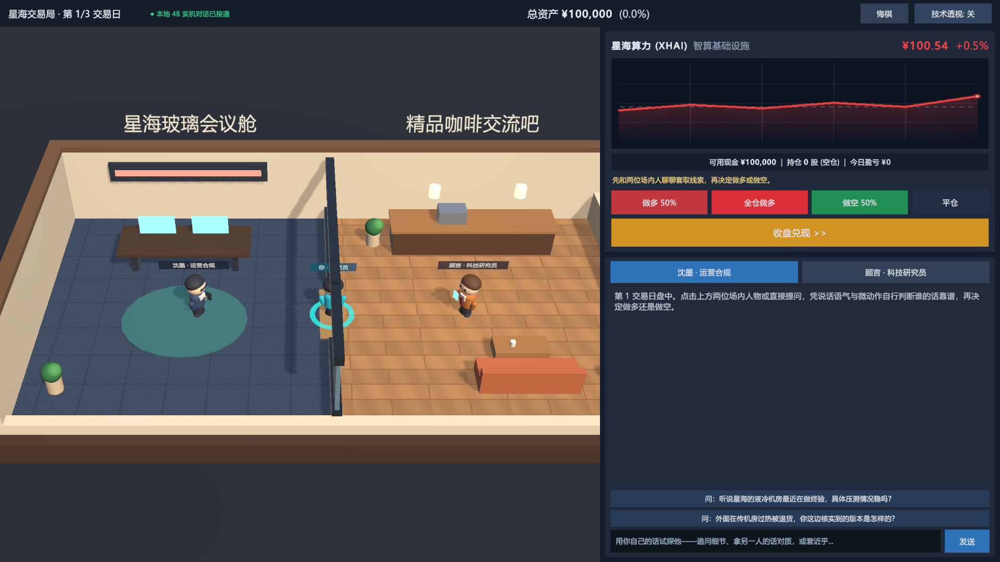
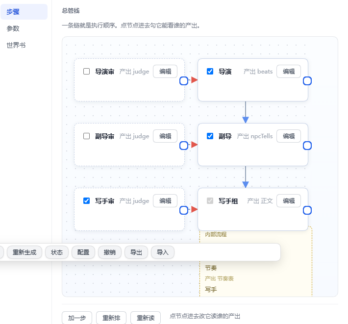
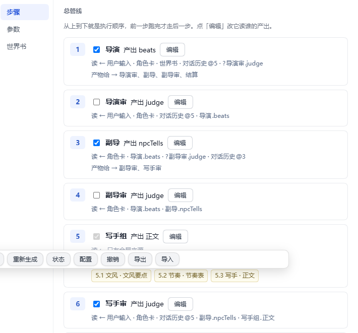
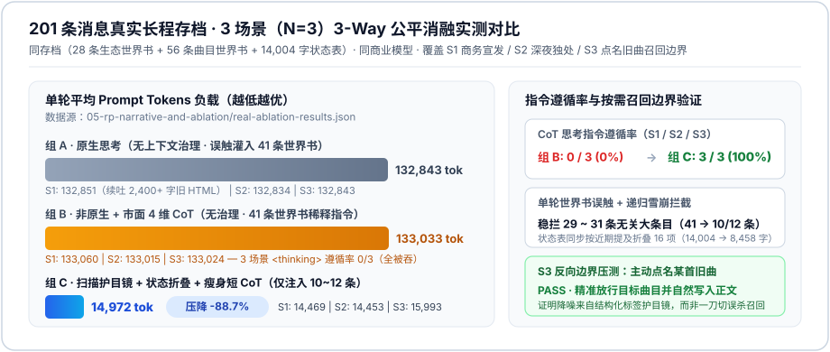

# 徐峰 · AI 评测（Eval）、玩法系统设计与质量工程作品集

**AI 玩法与智能 NPC 系统设计 · AI 评测（Eval）与质量工程（QA Lead，2020 至今）**

[](https://github.com/feng46430-cloud/ai-engineering-portfolio/actions/workflows/verify.yml)
[](https://github.com/feng46430-cloud/starlight-market-ai-npc-blueprint/actions/workflows/verify.yml)



本仓库收纳我主导设计与验收的 **5 项核心实证**：AI 评测打假与零加分门禁、商业游戏卡池概率守恒仿真、4 段全链路延迟拆解与底层排障、废弃低效画布的产品减法实录、以及文档×源码对齐的 5-Gate QA 流程。

---

## 按岗位快速直达

- **AI 评测（Eval）/ 策略 PM**：看 [**AI 评测打假实录**](./03-deterministic-guardrails/human-vs-ai-sparring-playbook.md)（拆穿 98% 假全绿、提出“记忆注入率 ≠ 对话表达率”）与 [**02 · 评测、5-Gate 与概率仿真**](./02-ai-eval-and-simulation/)（5,000 盒抽卡防摸包与期望守恒脚本）。
- **智能 NPC / AI 玩法与系统策划**：看 [**《星海交易局》3D AI-NPC 实验原型**](https://github.com/feng46430-cloud/starlight-market-ai-npc-blueprint)（前台藏底牌盲测博弈 + 规则层物理隔离账本与机密）与 [**01 · 多 Agent 编排产品减法**](./01-multi-agent-orchestrator/)。
- **游戏 QA 负责人 / 工程效能**：看 [**04 · 4 段延迟拆解与底层排障**](./04-systems-benchmark-and-governance/)（TCP/UDP 抓包、Profiler A/B 证伪、Windows 原子写并发与跨平台哈希定位）与 [**02 · 5-Gate 文档×源码防幻觉 QA**](./02-ai-eval-and-simulation/)。

---

## 5 项核心硬货（均附实机图、原始日志或可运行脚本）

### 1. AI 评测打假与 3D AI-NPC 引擎隔离实验（[独立原型仓](https://github.com/feng46430-cloud/starlight-market-ai-npc-blueprint)）
- **拆穿虚高评测**：早期压测报告 `98%+` 通过率，复盘揪出 8B 替考 4B、底线合规灌水与并发排队掩盖单玩家延迟三大问题。改用 **Gate 0 零加分一票否决 + 单玩家空载耗时（`concurrency=1`）+ 100 分体验重权** 后，将基线压回 `31.2 (F)`，同种子下一轮把 Top-3 开场白复读从 `36.4%` 压至 `5.3%`。
- **核心洞见（注入率 ≠ 表达率）**：Run 03 中旧监控记录记忆通过 `24/24`，抽检 4 条对话原文实际 `0/4` 体现记忆；同时记录了复测 `bge-reranker` 在“梭哈/死叉”处距误杀仅差 `0.0356` 的负向实证（证明通用检索精排不可替代专用安全模型）。
- **当前诚实状态**：原型基于 Unity 6 URP（2 名对手 NPC），本机 RX 7900 GRE 16 GiB 实测 4 模型专用显存 `9.30 GiB`（用于零云费开发与面试现场演示）；云端 `L4 BF16` 批跑尚未达 `B (≥65)` 可玩线，最新 Run 03（`48.62 · F`）的 4 项开放缺陷修复均**待下轮全包回归验真**。

---

### 2. 商业游戏概率 QA：5,000 盒五层卡池防摸包与期望守恒仿真（[`02`](./02-ai-eval-and-simulation/)）
- 用 Python 零依赖仿真对比三种抽卡实现：**朴素随机**（31.3% 空盒且 `1/1` 唯一卡超发 63 张）vs **尾包死保底**（尾包出货占比飙升至 `28.6%` 引发摸包黑产漏洞，且拉高 `+28.7%` 隐性期望通胀）vs **整盒保底 + Fisher-Yates 均匀洗牌 + 基础掉率补偿守恒 + `1/1` 全局耗尽锁**（空盒 `0%`、期望精确守恒 `1.10`、尾包占比回归均匀 `8.26%`、`mulberry32` 确定性复现）。
- 同目录另含 **5-Gate 文档×源码防幻觉 QA 规范**（拆离当前可测 / 未落地预留 / 跨文档冲突，前台白话与后台排查锚点分离）及多策略成长曲线校准脚本。

---

### 3. 硬核系统 QA：4 段端到端延迟拆解与底层根因排障（[`04`](./04-systems-benchmark-and-governance/)）
- **4 段控变量延迟拆解**：把跨采集、重建软件、网络传输与引擎后处理的延迟黑盒拆成 4 段独立测量（8 ms 高速逐帧 + 激光标定 + 双 VM 对照 + Unity Profile Analyzer A/B 证伪后处理开销），抓包定位原始 UDP 跳过握手导致的魔数 `actorId` 映射失效。
- **底层根因排障集**：覆盖 Windows `tmp+rename` 原子写与文件锁冲突触发的 `1/12` 偶发 `EPERM`、Git `core.autocrlf=true` 导致的 60 文件哈希全量误报、跨模型网关（Claude→Gemini）`assistant_prefill` 与 `reasoning_effort` 源码级兼容排查、以及 9 周多分支验收防返工治理。

---

### 4. 产品减法魄力：废弃已做完的节点连线画布（[`01`](./01-multi-agent-orchestrator/)）
- 多 Agent 工作台连线画布已完成坐标防冲突与曲线渲染，但实测高频调优拉线繁琐且极易断链，**果断推倒改为有序步骤列表 + 缩进子 Agent + 拖拽级联更新**；同期因 V1 `867` 条绿测暗藏 7 处假接线主导归零重构至 `v4.16.1`，核心单测收敛为 **`306/306 <1s` 全绿**。

| 废弃前：节点连线画布 | 重构后：有序步骤列表 + 缩进子 Agent |
| :---: | :---: |
|  |  |

---

### 5. 长对话上下文误触修复与防劣化治理（[`05`](./05-rp-narrative-and-ablation/) + [`03`](./03-deterministic-guardrails/)）
- **标签误触降噪实测（201 轮单存档 · `N=3` 对照）**：修复历史思考块与状态标签触发 31 条无关知识库的缺陷，使单轮 Prompt 从异常膨胀的 `133k` 回归 `15k` 基线（`-88.7%`），S3 点名旧条目精准召回不误杀（[原始 JSON](./05-rp-narrative-and-ablation/real-ablation-results.json)）。
- **独立只读复审与行为变更防劣化**：在 4 轮独立只读复审中实机拦截 `calendar-view.js` 异步懒加载覆写开关点击态的竞态 Bug；在私有引擎仓落地行为变更指纹校验（`changelog check`），防止调优期静默改坏阈值或默认提示词。



---

## 本地零依赖复现与完整目录（折叠区）

<details>
<summary><strong>展开查看：30 秒本地零依赖验证命令（Python 3 / Node.js）</strong></summary>

```bash
git clone https://github.com/feng46430-cloud/ai-engineering-portfolio.git
cd ai-engineering-portfolio

# 1) 5,000 盒五层卡池防摸包、期望守恒与 1/1 全局唯一锁仿真
python 02-ai-eval-and-simulation/demo-simulation/run_gacha_box_sim.py

# 2) 长周期数值曲线校准与单维阈值重叠反例脚本
python 02-ai-eval-and-simulation/demo-simulation/run_sim.py

# 3) 01 模块内存态校验演示单测（人工原话审批 + 写入前旧值防覆盖校验 HITL CAS，14/14 全绿）
node --test 01-multi-agent-orchestrator/mve/mve.test.mjs

# 4) 核验《星海交易局》Run 03 脱敏诊断 JSON（75% 权重重算 + 严格 F 级审计）
git clone https://github.com/feng46430-cloud/starlight-market-ai-npc-blueprint.git
python starlight-market-ai-npc-blueprint/repro/verify_scorecard.py
```

</details>

<details>
<summary><strong>展开查看：01–05 目录索引（兼容全部历史路径）</strong></summary>

- [**01 · 多 Agent 编排工作台与 6 份架构决策记录（ADR）**](./01-multi-agent-orchestrator/)
- [**02 · AI 评测、5-Gate 防幻觉规范、Token 审计与概率仿真**](./02-ai-eval-and-simulation/)
- [**03 · AI 评测打假、产品止损实录与双 Agent 只读复审**](./03-deterministic-guardrails/)
- [**04 · 4 段延迟控变量拆解、分支治理与 5 大根因排障**](./04-systems-benchmark-and-governance/)
- [**05 · 长对话标签误触降噪与 CoT 瘦身实测数据**](./05-rp-narrative-and-ablation/)

</details>

---

*声明：本仓库架构规格、评测体系、止损决策与质量验收由本人主导，协同 AI Coding 工具实现；通用方法论均为脱敏独立抽象，不含前/现任职企业 NDA 资产或受版权保护语料。文档采用 CC BY-NC-SA 4.0，脚本采用 MIT 协议；完整工程环境支持面试按需现场演示。*
