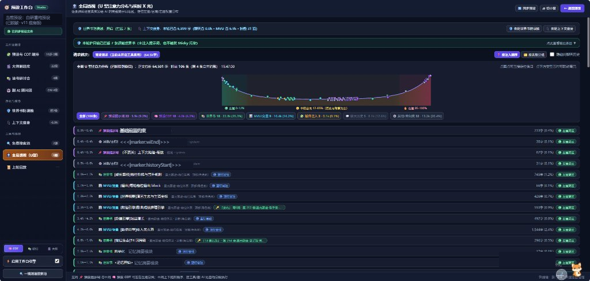

# AI Interactive Systems, Evaluation & Deterministic Harness Portfolio

> **定位**：6 年一线游戏 QA & 0→1 QA Lead 背景的 **AI 交互叙事与世界模拟设计者 / AI 评测（Eval）实践者 / 技术向 AI 产品与工作流设计者**。  
> **分工与边界说明**：本仓库中的所有自动化脚本与工具原型均由 **本人主导问题定义、规则与架构设计、异常边界约束及实机验收，协同 AI Coding 工具落地实现**。仓库保持单层清爽结构，不堆重复文案；每一项结论都直接挂钩可阅读原件、真实实测数据或可运行脚本。

---

## 一、按目标岗位直接看哪块（零重复导航）

| 你正在招的岗位方向 | 优先看这 2 个目录 | 核心真证据 |
| :--- | :--- | :--- |
| **智能 NPC / AI 玩法策划 / AI 互动叙事** | **[05 · 叙事预设原件与 201 楼消融](./05-rp-narrative-and-ablation/)** · **[01 · 多 Agent 编排](./01-multi-agent-orchestrator/)** | 现役重构预设纯文本原件（`-78.2%`）· 约 3 万楼/3 题材实证 · 6 份 ADR · 废弃画布改列表复盘 |
| **AI 内容策略 PM / 大模型评测（AI Eval）** | **[05 · 201 楼 3-Way 公平消融](./05-rp-narrative-and-ablation/)** · **[02 · AI 评测与仿真](./02-ai-eval-and-simulation/)** | N=3 多场景实测 Prompt **`-88.7%`**（CoT 遵循 `0/3→3/3`、按需召回不误杀）· 500 轮仿真脚本 · 1,177 全库复审 |
| **AI 应用 PM / 工作流与 UGC 工具产品** | **[01 · 多 Agent 编排工作台](./01-multi-agent-orchestrator/)** · **[03 · 确定性护栏治理](./03-deterministic-guardrails/)** | V1→V4 归零重构（-79%）· 有序步骤列表 + 单/多 Agent 无损切换 · 2 份商业工具 PRD 原件 |
| **AI-Native 测开 / 游戏测试经理 / QA 效能** | **[02 · 5-Gate 防幻觉 QA](./02-ai-eval-and-simulation/)** · **[04 · 系统评测与治理](./04-systems-benchmark-and-governance/)** | Unreal MCP 测试场（`70%→98.6%`）· Gate 5 校验脚本 · 4 段延迟拆解方法论 & 6 设备横评复盘 |

---

## 二、五大模块 STAR 一览

| 模块 | S / T（解决的真问题） | A（本人主导的关键动作） | R（可验证结果） |
| :--- | :--- | :--- | :--- |
| **[01 · 多 Agent 编排与审校工作台](./01-multi-agent-orchestrator/)** | 单轮长 Prompt 注意力稀释、自审失效、V1 过度耦合难维护 | 主导归零重构并沉淀 **6 份 ADR**；确立引擎领域无关 + 白名单隔离 + 独立判官打回；实测砍掉低效连线画布改有序列表 | 整体复杂度压减 **~79%**，单测秒级全绿，持续迭代发版至 `v4.16.1` |
| **[02 · AI 评测、防幻觉 QA 与动态仿真](./02-ai-eval-and-simulation/)** | AI 照着过期文档编造假用例；长周期多变量规则上线后易死锁失衡 | 叫停 1,162 条 AI 用例并建立 **5-Gate 文档×源码核验 SOP** 与 1,177 条独立读回复审；设计 **500 轮数值仿真**与 CI 三维归因 | 商业项目拦截 **400+** 需求缺口，测试场覆盖率 **70.0% → 98.6%**（P0 **100%**）；仿真上线前拦截 **11** 项缺陷 |
| **[03 · 确定性护栏与质量治理体系](./03-deterministic-guardrails/)** | 模型不擅长公平随机与格式闭合；黑名单禁令越堆越失效 | 确立「让模型读而非算」，落地真随机防作弊、嵌套语法修复、两级偏好压缩、换轴判据与双 Agent 交叉复审 | 862 字散乱补丁精简为 3 条公理；开源二次开发 **5 管线合一**、图片压 **54%**、**36** 套单测全绿 |
| **[04 · 软硬件系统评测与研发治理](./04-systems-benchmark-and-governance/)** | 国际 VR 虚拟赛事需量化多段体感延迟、选定动捕方案并根治分支返工 | 独立完成 **4 段延迟拆解**与 6 设备强磁压测；定位第三方动捕 SDK 协议故障；重构 9 周分支验收流与 2 份工具 PRD | 拍板**核心 5 节点穿戴方案**；冒烟耗时由 **3 人 20–30 分钟压至单人 5–10 分钟**；沉淀 656 条用例与脱敏方法论复盘 |
| **[05 · 长程叙事预设原件与 201 楼公平消融](./05-rp-narrative-and-ablation/)** | 长程互动上下文动辄 13 万 Token 烧钱且丢指令，缺多场景公平实测 | 彻底重写现役叙事预设（`55,890→12,170` 字）；在 201 楼真实原卡覆盖 3 类场景（含点名旧曲召回边界）做 3-Way 公平消融 | N=3 均值 Prompt **`-88.7%`**（总量 **`-88.0%`**）、CoT 遵循 **`0/3→3/3`**、点名旧曲精准召回不误杀；附脱敏规则原件 |

---

## 三、自研工作台实机运行界面一览（已脱敏）

> 以下均为本人自研工作台在真实长程存档上的**实机运行截屏**（仅对接口地址、模型别名与第三方条目名做最小化脱敏，零拼接假图）。

| 全局 U 型注意力透视与实时 X 光（本轮折叠 31 项 / 省 6,899 字） | 世界书扫描护目镜（自动识别 41 个标签 / 实机拦截误触明细） |
| :---: | :---: |
|  |  |

> 更多高清实机截屏（有序步骤 CoT 拖拽编排与自动结构化执行流、独立 API 隔音室防从众辩论、副 AI 审校判官与 `see` 最小视野白名单、22 位真实大师剧组与范文仿写库）分别嵌在 **[01](./01-multi-agent-orchestrator/)** 与 **[05](./05-rp-narrative-and-ablation/)** 模块中。

---

## 四、可直接检验的原件与脚本索引

| 类型 | 入口链接 | 说明 |
| :--- | :--- | :--- |
| **自研叙事与世界模拟原件** | [`narrative-preset-core-modules.md`](./05-rp-narrative-and-ablation/narrative-preset-core-modules.md) · [`world-simulation-rules.md`](./05-rp-narrative-and-ablation/world-simulation-rules.md) | 现役重构预设纯文本原件（`-78.2%`）+ 六档三支柱晋升/确定性锚点成绩引擎/多水流世界视野原件 |
| **201 楼真实消融实采** | [`05-rp-narrative-and-ablation/real-ablation-results.json`](./05-rp-narrative-and-ablation/real-ablation-results.json) · [`run_live_st.mjs`](./05-rp-narrative-and-ablation/run_live_st.mjs) | 脱敏实采 JSON 与本地 ST 公平实测脚本（含 3-Way 消融、4 轮隐式降温与 `A∩B→C→D` 原文） |
| **可运行 500 轮仿真** | [`02-ai-eval-and-simulation/demo-simulation/run_sim.py`](./02-ai-eval-and-simulation/demo-simulation/run_sim.py) | 零依赖 Python 3 脚本：复现冷启动死锁/年流失 39% vs 校准收敛 |
| **可运行 Gate 5 校验器** | [`02-ai-eval-and-simulation/demo-simulation/validate_csv.py`](./02-ai-eval-and-simulation/demo-simulation/validate_csv.py) · [`sample_testcases.csv`](./02-ai-eval-and-simulation/demo-simulation/sample_testcases.csv) | 零依赖 Python 3 脚本：双层用例样表 + 编码/防重/乱码确定性门禁 |
| **架构与评审规范** | [`adr-highlights.md`](./01-multi-agent-orchestrator/adr-highlights.md) · [`patterns.md`](./01-multi-agent-orchestrator/patterns.md) · [`token-economics-audit.md`](./02-ai-eval-and-simulation/token-economics-audit.md) · [`dual-agent-review-sop.md`](./03-deterministic-guardrails/dual-agent-review-sop.md) · [`13-dim-redteam-rubric.md`](./03-deterministic-guardrails/13-dim-redteam-rubric.md) · [`engineering-postmortems.md`](./04-systems-benchmark-and-governance/engineering-postmortems.md) | 脱敏 ADR 精选、权限三问法、U 型注意力审计、双 Agent 复审 SOP、红队记分与 5 大根因排障 |
| **外部公开源码** | [chat-autobackup（GitHub）](https://github.com/feng46430-cloud/chat-autobackup) | 独立源码级排障发布的浏览器扩展（根治隐藏系统消息导致的计数偏移） |

> **边界与声明**：本仓库所有案例、数据与脚本均已彻底脱敏，不含任何公司专有代码、商业机密、密钥或第三方受版权保护素材；涉及第三方开源项目二次开发的案例均已明确标注来源。
